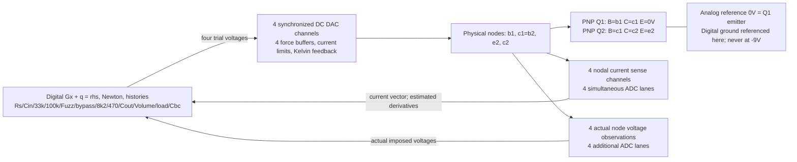
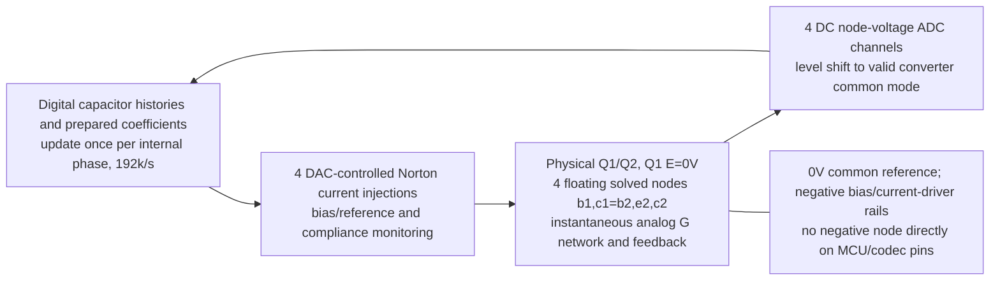
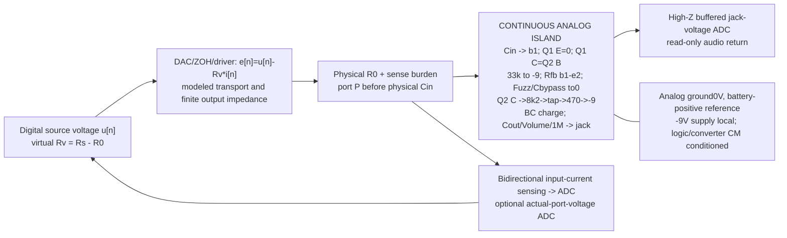

# SF-004 — can a physical germanium pair replace GP evaluation?

Research date2026-11-11. **No hardware built, purchased, rewired or measured.**
Production DSP, default evaluator, firmware, existing tests, correspondence rules
and production schematics are unchanged. This is an architecture investigation.

The physics can replace calculation. The difficult part is coupling a physical
device to virtual resistors and capacitors with the required timing and accuracy.
Moving more of that network into analog removes repeated digital interrogation,
but reduces how freely the circuit can be edited in software.

## Answers to the five acceptance questions

1. **Existing stereo audio converters cannot replace this device evaluator.**
   They lack the pair's four independent drives/current measurements, suitable
   DC readout, and the full loop timing/precision. This does not rule out fast
   external instrumentation or a different continuously settling partition.
2. **A genuine device interface needs multiport force/sense hardware.** At least
   four DC voltage drives and four current channels for the connected pair;
   four Kelvin voltage observations are strongly indicated. Add suitable rails,
   current limits, calibrated amplifiers, synchronized sampling and a derivative
   estimation/new solver contract. A stereo audio I/O pair is not that interface.
3. **A practical small island needs much of the local network.** The Q1/Q2
   connection, bias,100k feedback, Fuzz/bypass and collector loading must act
   together continuously. Keeping most passives virtual instead requires an
   analog companion-matrix or bidirectional port interface; neither is free.
4. **A hybrid is plausible, conditionally.** A continuously biased nonlinear
   island with local passives and carefully chosen electrical ports is credible
   physics. Its useful parameter/fault range, calibration, conversion burden,
   active-loop stability and benefit versus native M7 remain unproven. A fixed
   analog audio send/return is easier but is not the proposed substitution.
5. **No-go for drop-in A; conditional research for B; no build decision.** The
   smallest physical discriminator, after separate authorization, is an existing
   borrowed island with one measured source-impedance boundary and controlled
   feedback delay. First finish the blocked clocked nonlinear desktop test.

## Ground truth, pins and evidence vocabulary

Base is main440a99221af7cc3f3b7123db327bb161306d4856 after merged PR19. All required
repository instructions were present. Clean Debug and Release each passed16/16
before research edits. [ADR005](adr/ADR-005-germanium-fuzz.md), the native
`germanium_device.h`/`parable_germanium.cpp`, and original independent ngspice
fixtures are the electrical authority for this comparison, not a generic fuzz.

[PR21](https://github.com/amstarhd-dev/parable/pull/21), headb2b1bf4, is still
unmerged research context. Its final GCC13/O3 host H64 result is positive and
its O2/toolchain results mixed or negative. The issue's shorthand “host slower”
is not a universal conclusion. None proves an actual Daisy deadline failure.

“Calculated” below means arithmetic/model analysis; “simulated” means offline
SPICE or the explicitly labelled resistor surrogate; “datasheet” means specified
conditions, not a measured chain. **M7 cycles, physical settling/noise, board
compatibility and founder listening are unmeasured.** Machine-readable budgets,
source dates/revisions/PDF SHA256s and evidence are under
`tests/fixtures/sf004/`; reproduce with `tools/sf004/README.md`.

## The exact electrical object

Physical positive ground is0V; battery negative is−9V nominal (supported supply
magnitude6..9V). Let solved physical voltages be
`V=[b1,c1=b2,e2,c2]`; native coordinates are `x=-V`.

| Terminal relationship | Native function arguments | Nominal physical value |
| --- | --- | ---: |
| Q1 emitter | tied to0V | 0V |
| Q1 base | `ve1=-b1=x0` | −.07321784V |
| Q1 collector = Q2 base | `vc1=c1-b1=x0-x1` | −.21147201V |
| Q2 emitter | `ve2=e2-c1=x1-x2` | −.16183416V |
| Q2 collector | `vc2=c2-c1=x1-x3` | −7.55228031V |

Each `device(ve,vc,p)` returns collector/base currents and four partial derivatives.
Define positive currents **out of** the PNP base/collector into the external
network. The nonlinear four-node injection is
`[Ib1, Ic1+Ib2, -(Ic2+Ib2), Ic2]`; Q1 emitter closes the ground return.
Four net-node current measurements suffice mathematically: recover
`Ib2=-j_e2-j_c2`, then `Ic1=j_c1-Ib2`. Subtraction worsens uncertainty; separate
base/collector sensing is an alternative, with its own insertion burden.

Independent DC KCL gives Q1 Ib≈+.886uA/Ic≈+270.579uA and Q2 Ib≈**−4.260uA**/
Ic≈+166.980uA. Current sensing must be bipolar. These are model predictions,
not measurements of a purchased part. Fault cases and full bias values remain
in the original fixtures. The fitted sample is cloned twice; its untrimmed Q2
bias is−7.55V, not a forced−4.5V.

## A — queried physical pair, all surrounding branches digital



There are four independent force nodes plus ground, not two audio terminals.
Q1 C and Q2 B are physically tied; no resistor, coupling or feedback branch in
the digital box is silently wired in analog. Real intrinsic transistor charge
remains physical. The virtual100pF BC terms cannot simply be added on top of
unknown real Cbc without de-embedding/double counting.

Separate grounded-emitter query cells are possible: for each device force
`B=-ve,C=vc-ve,E=0`, keeping inter-device connectivity entirely virtual. That
still needs four simultaneous voltage controls for two cells. Reusing one
transistor serially doubles probe rate, requires state/charge settling and cannot
independently assign Q1/Q2 leakage/gain. It is not an independent physical pair.

### Derivatives, state and safety contract

The existing previous-state warm start already reduces work. It does not supply
new Jacobians or make a stored derivative correct at a changed physical bias.
Forward differences need baseline plus two input perturbations; central
differences need baseline plus four. Both devices can be perturbed in parallel.
For the connected pair, in native coordinates, simultaneous BE-axis probing uses
`dx=[d,d,0,d]` and BC-axis probing uses `dx=[0,-d,-d,-2d]`; these hold the other
junction arguments fixed. Thus five states is a defensible central-difference
count, rather than naively requiring nine global-axis states.

Broyden/chord methods, persistent small-signal excitation or analog derivative
estimators could reduce fresh probes, but change the solving/uncertainty contract.
Lock-in perturbations also need observation time and disturb the operating point.
No such method is implemented or assumed equivalent. Charge currents during trial
voltage changes differ from the static GP conduction values the solver expects.

The `ve,vc` guard[-12,.8]V is a **numerical search domain**, not a safe operating
area for a real germanium part. It admits reverse junction bias and huge forward
currents outside this reduced fit's validation. Even the connected-node common
mode bounds can extend well beyond the normal−9..0V operating region. Never send
that full grid to a physical DUT. A part-specific safe domain/current limit would
be a new contract, not transparent substitution of the existing evaluator.

### Interaction budget, calculated from the actual workload

Nominal514192 exponentials/4096 base samples gives125.5352 exps/base sample,
15.6919 **coupled pair evaluations**/sample,753210.94 pair evaluations/s at48kHz,
and1506421.88 individual device evaluations/s. Internal phase interval is5.208us
(4×48k); base interval20.833us. Four exponentials per device means8 per pair
evaluation. These are different from both ADC lanes and the earlier pluck count.

| A method | Pair states/s nominal | Maximum mean serial state budget | Static-bound states/s | Static state budget |
| --- | ---: | ---: | ---: | ---: |
| currents only, Jacobian somehow known | .753211M | 1327.65ns | 4.8M | 208.33ns |
| forward differences,3 states | 2.259633M | 442.55ns | 14.4M | 69.44ns |
| central differences,5 states | 3.766055M | 265.53ns | 24M | 41.67ns |

These are optimistic upper budgets **before** matrix assembly/elimination,
history/FIR work, communication and scheduling. Static bound is4 phases×25
evaluations, not a measured per-sample deadline miss. Average budgets do not
establish worst-case feasibility. With4 DAC+4 I-ADC+4 V-ADC16-bit lanes, nominal
central-difference payload alone is723.08Mbit/s, excluding framing/configuration.
Lane rate is3.766MSPS; aggregate observations are not “one ADC at30MSPS.”

### Converters are available; precision and round trip still matter

The official [Seed3](https://docs.daisy.audio/hardware/Seed3/) uses TAC5242. The pinned SDK1289a000 configures48kHz/24-bit;
advertised192kHz/32-bit capability is not a measured configuration. TAC5242
target-mode24-bit operation selects linear-phase filters; the low-latency option
uses32-bit. Actual board straps and serial-slot alignment were not hardware-verified.

| TAC5242 datasheet mode | ADC+DAC filter delay | Filter-only time |
| --- | ---: | ---: |
| 48k linear phase | 17+17.3 frames | 714.58us |
| 48k low latency | 6.6+7.19 frames | 287.29us |
| 192k linear phase | 11.6+10.7 frames | 116.15us |
| 192k low latency | 6.8+5.41 frames | 63.59us |

These sums exclude sample age, buffers, firmware and analog stages; published
flat-delay bands differ by mode. They are not measured round trips. The ADC HPF
removes DC (1Hz or12Hz at48k, no bypass in the pin table), so raw BJT DC currents
cannot be recovered as if it were a precision DC ammeter. Negative−9V nodes also
cannot connect directly to3.3V-referenced codec/MCU pins.

The pinned application requests48-frame blocks at48kHz: a **1ms scheduling
scale**, separately from filter delay. Exact DMA/sample-age/round-trip latency
has not been measured. A submicrosecond queried-device handshake is not provided
by that callback. A different hardware scheduler/interface would be a new
architecture, not a change to the existing audio block size in this research.

As counterexamples to “all converters are audio-rate,” AD7380-4 provides four
simultaneous16-bit4MSPS lanes:250ns cycle, max190ns conversion, normal one-cycle
readback with a low-latency read option. At80MHz,16 read clocks alone cost200ns
in4-wire mode. Its fast sequential read/convert path is not zero-latency. AD3552R
offers dual16-bit33MUPS DACs, but needs external TIAs and1.8V logic interfacing.
Its100ns2V settling number is to **0.1%**, not16-bit accuracy. These parts make
fast instrumentation plausible in principle, not a verified Parable solution.

Do not simply add all conversion times as if nothing can overlap. The five
precomputed perturbation states can be pipelined; the next Newton iteration
still depends on the final current/Jacobian results. An illustrative5-state
batch budget using100ns initial settling, four250ns conversion cycles,190ns
last conversion and200ns last readout is1490ns before DUT/sense/CPU overhead,
versus1328ns nominal per coupled evaluation. This mixes a quoted typical DAC
settling value and a maximum ADC conversion value: it is a budgeting example,
not a measured latency or universal lower bound. Extra parallel hardware can
change it. The static24M state/s requirement exceeds the example ADC's4MSPS
lane rate regardless. Full-chain settling is not SPI-write throughput(AN-1444).

Illustrative16-bit current span±1mA gives30.52nA/LSB, about305× the native100pA
residual threshold. Ideal quantization alone needs25 bits to resolve that residual
over2mA; the1pA mathematical-comparison floor would need31. Neither is an ENOB
or noise guarantee. With±100uV central perturbations, one-LSB current-difference
uncertainty corresponds to152.6uS derivative error. Finite-difference bias and
noise must be budgeted too. The ideal Poisson shot-noise scale at270uA and1MHz
is9.3nA RMS; that is a calculation, not a measured AC128 noise floor.

Force impedance matters: a10-ohm emitter sense burden at163uA shifts voltage
about1.63mV, appreciable beside the~29mV forward emission scale. Kelvin feedback
and measured pin voltages are needed, with amplifier stability into DUT charge.
For a single-pole16-bit settling target, `t≈ln(65536)/(2πBW)`; spending the entire
1328ns current-only budget on settling needs~1.33MHz bandwidth, while208ns needs
~8.47MHz. Actual chains need more margin and measured large/small-signal response.

References: [TAC5242 Rev.A](https://www.ti.com/lit/ds/symlink/tac5242.pdf),
[AD7380-4 Rev.A](https://www.analog.com/media/en/technical-documentation/data-sheets/ad7380-4.pdf),
[AD3552R Rev.B](https://www.analog.com/media/en/technical-documentation/data-sheets/ad3552r.pdf),
[AN-1444](https://www.analog.com/en/resources/app-notes/an-1444.html).
Versions, dates and downloaded PDF hashes are recorded separately.

## B — let the coupled analog network evolve continuously

Two variants deserve separate treatment. Both eliminate measured Jacobians;
neither is achieved by plugging two bare BJTs into audio I/O.

### B1: analog companion-equation solver



Realize `G*x + q(x) = rhs(history,input)` as an analog network: passive prepared
conductances between the four nodes/ground, physical BJTs, and held current
injections. Physics finds the coupled operating point; the digital side updates
histories from one settled voltage snapshot. Minimum4 injection-DAC+4 voltage-ADC
channels, with additional sensing desirable for calibration. Rate is192k phase
updates/s, **not753k Newton probes/s**. This explicitly answers the continuous-
settling hypothesis without demanding physical Jacobians.

However, the instantaneous linear network must be analog too. At192k, a100pF
BC companion conductance is38.4uS (26.04k equivalent). The eliminated Fuzz/bypass
branch is more difficult:

| Fuzz | Effective emitter conductance | Equivalent R | Conductance current at nominal bias | Opposing history current |
| --- | ---: | ---: | ---: | ---: |
| 0 | .001S | 1000ohm | .162mA | 0 |
| .8 | .00499675S | 200.13ohm | .809mA | .647mA |
| 1 | **7.681S** | **.13019ohm** | **1.243A** | **1.24289A** |

This is cancellation in a literal unscaled Norton realization; the physical
20uF capacitor does not draw1.24A DC. Bias-centred coordinates, scaled current
conveyors or a charge-domain analog computer might avoid that exact burden,
at the cost of more amplifiers, matching, noise and feedback analysis. This
calculation rejects the naive implementation, not all analog computation.
Keeping the real bypass capacitor and Fuzz network local avoids that cancellation
but moves their state and variation into hardware. Real junction charge also
has to be accounted for rather than added twice to the virtual100pF model.

For B1, only fast parasitic/driver equilibration needs to fit a phase's~5.2us
budget; no measured settling result is available. For B2 below, the actual signal
capacitors should **continue evolving**, not settle to DC every audio sample.
Their memory is the intended circuit behaviour. Startup/patch-change settling is
a separate issue.

Reserving4us of B1's phase for a single-pole16-bit equilibration would require
~.441MHz bandwidth; DAC, ADC/readout and digital history work must fit the
remaining~1.2us. This is an illustrative allocation, not a measured multi-pole
settling bound or a guaranteed analog design.

### B2: local nonlinear island with electrical boundary ports

The conservative continuous island includes the pair,33k collector1 resistor,
100k feedback,1k Fuzz pot/20uF bypass, real BC charge,8.2k/470 collector2 path,
and the−9V bias source. A two-port cut can leave Cin/source and Cout/Volume/load
digital: P1 atb1 and P2 at the collector tap. Each port needs effort/current
coupling, a real termination and conversion—not an ideal unilateral buffer.
Two such ports need at least2 drive DACs,2 current ADCs and2 voltage ADCs. Both
are DC-biased ports; the tap is approximately−8.92V. This is not codec-ready.

The smaller **codec-compatible candidate** puts Cin2.2uF and Cout10nF/Volume/
declared1M load inside too. It leaves one bidirectional input port before Cin,
plus a read-only buffered jack output. Only the source impedance remains virtual
in the desktop experiment:



The diagram is an architectural boundary, **not a production schematic**.
For the one-port candidate: minimum1 drive DAC,1 current ADC and1 output-voltage
ADC; calibrated port-voltage observation adds1 ADC. A normal guitar-input ADC
and final audio-output DAC are additional. Existing stereo conversion channels
cannot be counted twice. A fixed analog send/return can fit a mono channel
allocation, but does not provide this extra electrical return/monitoring.

The sampled return current makes the virtual source resistor an actual part of
the circuit equation. Removing that return and wiring all Rs locally gives the
ordinary fixed-analog baseline. It may be useful, but is not the claimed virtual-
component substitution. Conversely, leaving Cout/Volume/load virtual reintroduces
another two-way loading interface; an unloaded audio measurement cannot represent
an arbitrary virtual load.

### Stability is a property of the boundary, not of “analog speed”

For a voltage-type port, a linearized return ratio contains
`L(s)≈(Zvirtual/Zisland)*Hdriver(s)*Hsensor(s)*exp(-s*tau)`, plus the sampler/hold.
Large virtual impedance relative to the physical termination can make a delayed
otherwise-passive resistor implementation unstable. The actual two-port case is
a matrix return-ratio problem; the battery-powered nonlinear island is active.

For perspective, pure300us transport adds108degrees at1kHz; a45degree delay
allowance at20kHz is only6.25us. These are arithmetic examples, not the circuit's
measured phase margin or a substitute for Nyquist analysis. Sample/hold contributes
additional phase and images. FIR/codec filters, amplifier poles and current-sense
burden belong in the loop model.

Wave variables `a=(v+R0*i)/(2*sqrt(R0))`, `b=(v-R0*i)/(2*sqrt(R0))`, with positive
reference R0 and current into the island, offer a useful alternative. A passive
digital environment can be connected through a delayed scattering interface
without the same naive voltage-feedback instability. The delay still changes
the electrical circuit; active transistor/supply energy, nonlinear incremental
impedance, port matching and saturation need a separate proof. It is not a
blanket passivity/stability guarantee for this fuzz. Multi-rate coupling can
reduce bandwidth but then audio-rate impedance/failure behaviour is approximate.

Stability alone would not preserve the desired impedance. For a simple passive
wave-line calculation, `Gamma=(Rs-R0)/(Rs+R0)` and
`Zin=R0*(1+Gamma*exp(-s*tau))/(1-Gamma*exp(-s*tau))`. With R0=100ohm at1kHz:

| Desired Rs | No delay | 1us total return delay | 300us total return delay |
| --- | --- | --- | --- |
| 1k | 1000ohm | 999.0−j31.1ohm | 15.20−j71.55ohm |
| 50k | 50000ohm | 14420−j22651ohm | .306−j72.65ohm |

This is a passive-line calculation, **not this active fuzz's transfer function**.
Choosing physical R0=Rs makes Gamma=0 and avoids the reflected impedance error,
but moves that adjustable resistance into hardware. A matched or near-matched
programmable termination is a meaningful research alternative to naive feedback;
it does not preserve arbitrary virtual passives automatically.

Best case for B2 is local feedback plus unilateral observation: codec delay then
adds audible-path latency without entering the local electrical loop. That is
the fixed-island baseline unless an external impedance remains coupled. In the
bidirectional candidate, converter/filter/sample age is inside that port loop,
so the filter-delay numbers above cannot be treated as harmless feed-forward
latency. Neither case requires waiting for the signal capacitors to reach DC
between samples; their continuous state is retained.

The [PHiL stability paper](https://doi.org/10.3390/electronics11010007) supplies
delay/impedance/amplifier methodology, not a validation of this active nonlinear
network. [ADI's CTSD discussion](https://www.analog.com/en/resources/analog-dialogue/articles/ctsd-precision-adcs-part-2.html)
illustrates why inserting converters in feedback needs explicit loop shaping;
a CTSD ADC's internal continuous loop is not an externally delay-free transistor
interface.

## What remains physically causal, and what changes

| Relationship | A, queried device | B, local island |
| --- | --- | --- |
| Transistor current/leakage | real current plus sensing/settling error; static GP equivalence unproved | real unit/temperature/charge behaviour; not the cloned fitted sample |
| Source and guitar volume | virtual loading only unless a real input-loading interface exists | continuous local input network; virtual Rs still needs current return |
| 100k->10k wrong-feedback fault | stays digital, so delay is inside the coupling | local physical branch/switch must change; retain its actual burden |
| Q1 BC leakage7.546uA->75.46uA | cannot independently set it on one reused part | select/characterize another device or a justified physical leakage branch |
| Reactive history | virtual histories plus unwanted physical junction charge | local caps retain analog state, tolerances and startup history |
| Arbitrary passives/independent instances | digital freedom paid for with multiport querying | limited by physical values/control network; separate simultaneous instances need separate islands |

Heating a transistor changes more than BC leakage; a C-B resistor is not the
specified exponential leakage law. Neither is an equivalent fault implementation.
No correspondence/fault semantics are revised in this research. Analog switches,
capacitor banks or programmable conductances introduce finite ranges, tolerances,
parasitics and switching transients. Patch recall can store settings, not magically
restore a physical capacitor's previous charge or reproduce every unit's gain.

Likewise, a high-impedance guitar ADC has already imposed its own pickup load.
A later digital Rs or post-ADC analog island cannot retroactively recreate the
pickup/guitar-volume interaction of a~1k input. That requires an actual analog
input load, a front-end island or a properly coupled electrical port. In B2 the
coupling caps permit zero-DC audio ports and local bias; that is a real benefit
over A, purchased by moving those passives into hardware.

## Hardware complexity and possible computational savings

| Architecture | Signal hardware/implications | Relative complexity |
| --- | --- | --- |
| Unmodified all-digital GP | existing host/M7 path;7108B ARM object,2480B state from pinned prior evidence; target cycles unmeasured | no incremental analog hardware |
| A, calibrated pair query | 2 dual DACs,2 quad ADCs for4I+4V,4 force/4 sense/4 voltage-buffer functions, references, filtering, protection, timing controller | high instrumentation burden |
| B1 companion network |4 injection DACs+4 V-ADCs, programmable sparse G and current drivers, control/calibration; stiffness/current scaling unresolved | high/very high |
| B2 one-port island | physical local passives,1 fast drive, current sense+voltage/audio monitoring, safe terminations/control banks | moderate, rising with virtual freedom |
| Fixed analog island/audio send-return | local Rs and load too; no rapid current feedback or virtual passive freedom | lowest hybrid complexity; comparison baseline only |

A's fast interfaces need synchronous DAC updates, ADC conversion/read clocks,
CS/LDAC or equivalent triggers, multiple data lanes and fault/reset signals.
Two quad ADCs in4-wire readout expose8 output lanes; dual/serial modes reduce pins
by increasing transfer time. Two DAC chip selects and shared quad data/clock
still need a verified simultaneous-update scheme. No Seed3 pin allocation or
SPI/FPGA transport has been demonstrated. The AD3552R's~1.8V logic needs proper
interfacing to3.3V MCU logic. This is more than “two spare audio pins.”

Two5×5mm DAC packages plus two4×4mm ADC packages occupy82mm² **package area**
alone. That excludes amplifiers, references, routing, guards, regulators and
connectors; no total PCB area or manufacturable layout is established. Negative
analog force/bias rails,5V/1.8V converter rails and conditioned3.3V interfaces
need a real power plan. Ground0V is shared/reference-controlled; never connect
negative transistor nodes to digital pins or treat battery-negative as MCU ground.

Illustrative datasheet-only power arithmetic: two AD3552Rs at roughly
`5V*22mA+1.8V*53mA+1.8V*3mA` each, plus two AD7380-4s at163.1mW each, totals
about0.75W. These are different published operating conditions, **not a measured
or guaranteed board budget**; external TIAs/drivers, level shifting, references,
control logic and supply losses are excluded. The nominal passive/bipolar circuit
itself draws only~.433mA from9V in the reduced DC model (~3.9mW). Instrumentation
can dominate. No defensible production BOM/pricing was established; relative
tiers are used instead of invented dollars.

A can remove6.026M exp evaluations/s at the nominal workload, but retains the
four-node digital Newton work and adds derivative estimation/data transfer.
Without profiling, the fraction of total CPU time saved is unknown: if a fraction
p were eliminated perfectly, Amdahl's bound is`1/(1-p)`, before interface work.
Do not derive a speed multiplier from a device-only benchmark.

B can remove the coupled numerical solve too. B1 retains coefficient/history
updates and192k/s hardware coordination; B2 replaces much of the native circuit
with analog state. Neither removes converter filtering, routing, external effects
or control work. Analog generation does not alias internally in the same way as
a sampled nonlinearity, but its output still needs anti-alias filtering before
ADC. No actual M7 savings, analog-settling time or hybrid CPU/memory cost has
been measured. Computational savings must be weighed against latency, power,
instance count and reduced artistic/deterministic flexibility.

## Desktop experiments: results and the validation blocker

The pre-result [plan](../tools/sf004/PLAN.md) fixes tolerances and names all
assumptions. No gain normalization or fitted time shift is permitted. The ADC/DAC
are ideal16-bit quantizers for these experiments, **not a TAC5242 model**. The
300us case is only a codec-scale delay example; real filters, HPF, aperture,
jitter, noise, driver load dependence and device charge need further modeling.

**1. Continuous nonlinear electrical boundary, completed.** Reuse the original
independent ngspice GP stamps and complete circuit. Replace the source resistor
by a physical100ohm termination plus an ideal continuous controlled voltage
`e=u-(Rs-100)*i`. That is a real electrical coupling equation, not an ordinary
audio send. With zero delay/error it is algebraically equivalent to Rs. Seven
cases/1344 sampled rows compare against the committed original fixtures:

| Case | Jack RMS error | Jack peak error | Outcome |
| --- | ---: | ---: | --- |
| healthy_low | .158uV | .847uV | passes fixed gates |
| healthy_mid | .263uV | 1.273uV | passes fixed gates |
| healthy_high | .431uV | 2.259uV | passes fixed gates |
| source_high | .0106uV | .126uV | passes fixed gates |
| weak_input | .0275uV | .253uV | passes fixed gates |
| q1_leaky | .00123uV | .00358uV | passes fixed gates |
| feedback_wrong | .0961uV | .619uV | passes fixed gates |

Worst all-node peak difference is93.5uV, dominated by numerical integration/
time-grid differences. This validates the **continuous ideal boundary algebra**,
not a realizable zero-delay digital interface. Ngspice itself uses numerical
Newton to simulate the stand-in; its runtime is not physical settling time.

**2. Sampled nonlinear boundary, BLOCKED.** The first analog-switch/quantizer/
transmission-line converter stand-in aborts at a code transition. A second
method uses scheduled SPICE stop/read/quantize/alter/resume events with held DAC
words, finite sensor/driver poles,1ohm burden,100ppm current-gain error and1nA
offset. A simple RC check preserves capacitor history, but the nonlinear plant
still aborts at delivery events: fast192k/1us at~.511417ms;48k/300us at3.175ms.
Gear2 and trapezoidal attempts both expose integration problems. Original
reltol1e-8/abstol1e-13/vntol1e-10 are never relaxed.

These are **numerical execution failures, not evidence of physical instability**.
The script exits2 and never validates a short trace prefix. A reliable clocked
co-simulation connector, including event/state consistency at forcing changes,
is missing. A shared-library source callback or validated mixed-signal bridge
is the next desktop gate. Full nonlinear delayed/quantized equivalence therefore
remains **unproven**. This is the explicit deliverable3 fallback, not a claimed
successful virtual HIL prototype. Rejected deck/log and failure records remain.

**3. Quantitative delay diagnostic, completed but limited.** Separately simulate
a **constant1048ohm resistor surrogate**, inspired only by the model's~1kHz real
input impedance. It omits the transistor/capacitor dynamics and reactive input
impedance, so its stability result is not the germanium circuit's stability.
Use exact continuous two-pole propagation between sampled ADC and DAC events,
including the same quantization/error/burden assumptions above. Compare to a
continuous resistor circuit receiving the *same known forward-source chain*,
without fitting a delay or level after the fact:

| Virtual source Rs | Update/transport | Output error RMS | Clipped samples in50ms | Boundary budget |
| --- | --- | ---: | ---: | --- |
| 1k | 192k/1us | .260mV | 0 | fails |
| 1k | 48k/300us | 23.225mV | 0 | fails |
| 50k | 192k/1us | 912.084mV | 9597 | fails, limit cycle/saturation |
| 50k | 48k/300us | 912.080mV | 2381 | fails, limit cycle/saturation |

For the memoryless one-sample limit, pole `z=-(Rs-R0)/(Rproxy+R0+burden)` is
−.7833 for1k, and−43.429 for50k. This explains why a virtual positive resistor
can become a problematic active delayed implementation. Finite sensor/driver
settling is modeled separately in the diagnostic. A bounded trace without clips
can still fail fidelity. The fixed additional error budget is jack/output RMS
≤.2mV, peak≤1mV and input RMS≤.1uA; all four cases fail it. No thresholds were
changed to make an architecture look viable.

This diagnostic supports the **need for a coupling/stability design**, not a
no-go theorem for wave-variable interfaces, all analog islands or all faster
converters. The nonlinear sampled experiment remains blocked regardless of
the resistor experiment's clean numerical execution.

## Evidence disposition and next smallest test

| Gate | Status |
| --- | --- |
| Exact four-node electrical/Jacobian/rate contract | derived from pinned source and fixtures |
| Continuous ideal island/source coupling | seven independent-SPICE cases reproduced |
| Quantized delayed interface diagnostic | reproduced for resistor surrogate only; fails budgets |
| Full nonlinear sampled converter/island validation | **blocked by numerical event/integration behaviour** |
| Actual ADC/DAC/amplifier/DUT settling and noise | **not measured** |
| Daisy cycles/deadline, physical circuit, listening | **not measured/performed** |
| Production/default/firmware/model tests/astrology changes | **none** |

Recommendation: retain native GP; no-go for an unchanged evaluator drop-in,
conditional architecture research for an island. No board/parts commitment.
First resolve the desktop connector and run a proper MIMO/stability analysis
with a characterized port. That must precede claims of preserving the full
nonlinear behaviour under conversion delay.

The **single smallest real-world discriminator**, after separate authorization
and only if an existing fixture can be borrowed, is one instrumented input port
of an already wired two-transistor/local-feedback island. Capture actual port
voltage/current and incremental admittance, then introduce a controlled return
delay while emulating one source-resistance step, comparing1k and50k. Measure
settling, phase, clipping and gain against the same-stimulus reference, with
current limits and an explicit safe bias range. It distinguishes meaningful
electrical coupling from a simple audio send and tests the suspected high-Z
boundary problem. It does not authorize assembling an island, purchasing test
equipment, extrapolating to all passives or constructing a product PCB here.

## Reproduce and review scope

From repository root, C++17/CMake>=3.15/Python>=3.9:

```bash
cmake -S parable-starter -B build/sf004-Debug -DCMAKE_BUILD_TYPE=Debug
cmake --build build/sf004-Debug -j2
ctest --test-dir build/sf004-Debug --output-on-failure --no-tests=error
cmake -S parable-starter -B build/sf004-Release -DCMAKE_BUILD_TYPE=Release
cmake --build build/sf004-Release -j2
ctest --test-dir build/sf004-Release --output-on-failure --no-tests=error
PYTHONDONTWRITEBYTECODE=1 python3 parable-starter/tools/sf004/check.py
python3 parable-starter/tools/sf004/budget.py --output /tmp/sf004-budget.json
python3 parable-starter/tools/sf004/linear_port.py --output /tmp/sf004-linear.json
python3 parable-starter/tools/sf004/coupled_spice.py --ngspice /path/to/pinned/ngspice44.2 --output /tmp/sf004-continuous --mode continuous
PYTHONDONTWRITEBYTECODE=1 python3 parable-starter/tools/sf004/check.py --continuous /tmp/sf004-continuous/results.json
```

Local baseline directories are /workspace/work/sf004-before-Debug and
sf004-before-Release; before edits16/16 passed in66.52s and16.49s. Existing
offline simulator is Debian44.2+ds-1, SHA256
`4d76721dd91416055b1088cfc58626d4db47b91afda7c73258c0968ba6e4d24e`, already pinned
by SF003. No new runtime dependency or borrowed algorithm is imported. References
are consulted for facts; external datasheets/illustrations are not redistributed.

Changed files are this report, proposed ADR006, research-only arithmetic/
diagnostic/SPICE scripts, immutable evidence/source pins and a separate research
workflow. Original source/tests/firmware/CMake/constitution and original SPICE
fixtures are hash-checked unchanged. No new musical voice/WAV is claimed or
required for this architecture study. The numerical blocker is not hidden by
green host tests; research CI checks reproducibility and honest classification.
Open one unmerged research PR for independent review. Findings are hypotheses/
desk evidence and do not replace a hardware or founder approval gate.
