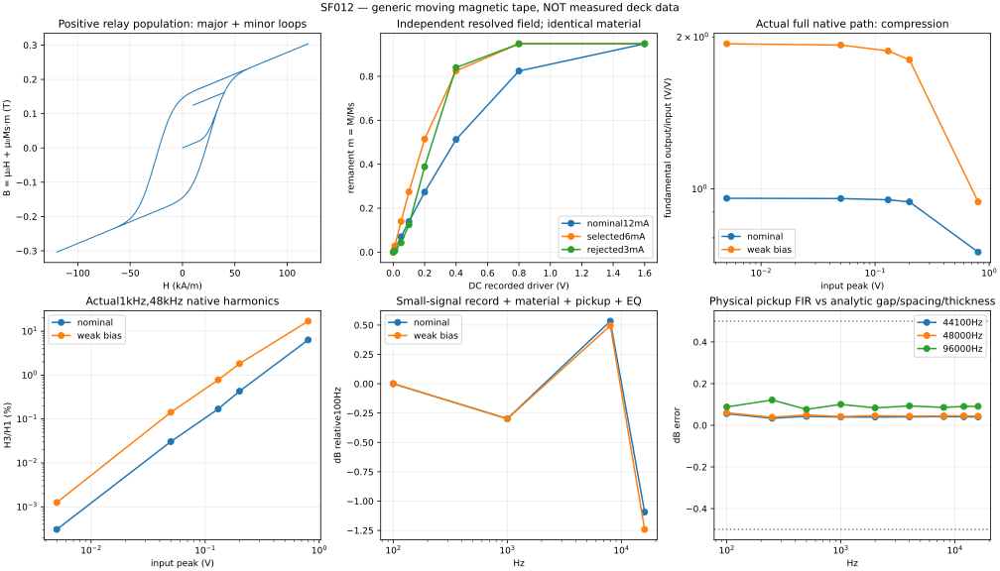
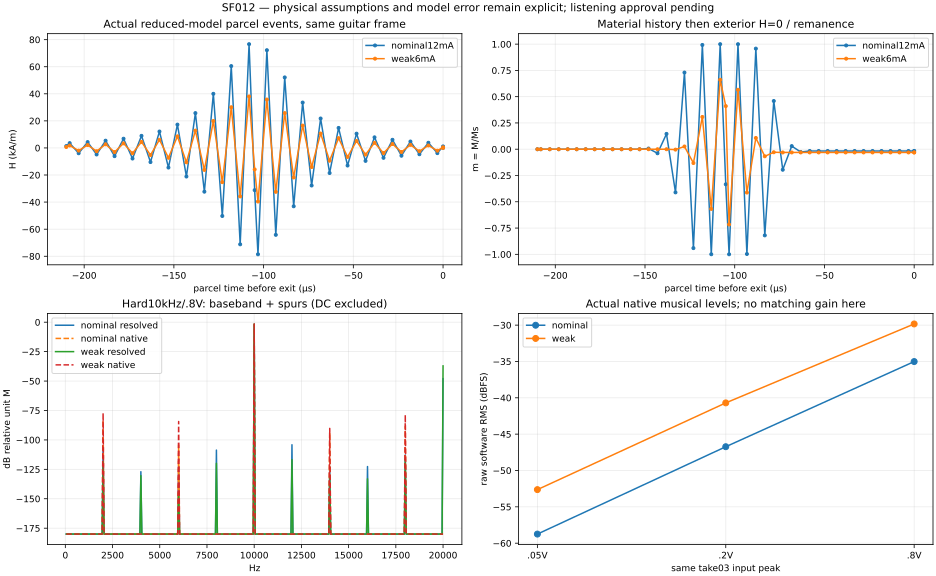

# SF012 — moving magnetic tape / one underbiased record driver

Experimental **standalone Soundforge voice**, not Engine/preset/firmware admission.
Issue55 founder addendum requires the identical Centaur Guitar-TECHS take03.
The delivered WAVs use the actual native C++ below, not a Python substitute.
Independent review, human listening approval and physical measurements remain open.

## Decision, scope and source rights

[Gate0](SF012_GATE0.md) was committed locally before native code (`fdd1395`).
[ADR012](adr/ADR-012-moving-tape-underbias.md) selects positive Preisach material
in fresh moving parcels. Initial/current main is
`c3aaca164e7a3f7d5b0106b3dd8dc89b7e1ef940` (independently merged #54).
Root AGENTS.md and the frozen correspondence Lexicon are absent; project AGENTS,
Constitution, kickoff/status and Soundforge/earlier voice reports were read.
#42/#48 remain open and untouched. No Engine, patch schema/contract, preset pool,
storage/activation/living, correspondence, firmware sources or old DSP edits.

Actual borrowed foundation: Isaac Kramer, `python-preisach`, MIT2023,
`0b27d738319e78160236068192aa7be3058bbbc9`: directional relay switching/hold
and normalized positive weights. Condense its ordered population into eight
Gaussian-center rows; retain [full MIT notice](../third_party/tape_saturation/Kramer-LICENSE.txt).
This is an adaptation, not a tape-calibrated upstream engine. JAmodel (MIT),
kiluam Preisach (MIT), CHOWTape (GPL3) and Faust (LGPL with generated-code exception)
were inspected and rejected/audit-only for the reasons in Gate0. The unchanged
MIT/BSD2 source-import policy is not widened. Infinite Digits' related commercial
moving-cell explanation is reference-only, no source grant/import or novelty claim.
All revisions, exact files and primary-document URL/SHA pins are in
[provenance](../third_party/tape_saturation/provenance.json).

Physical references: McKnight, *Biasing in Magnetic Tape Recording* (1967),
RTM SM9112022 data sheet, Chowdhury DAFx2019 and Karlqvist derivations. No artwork,
plots, commercial DSP or copyrighted prose is copied. SM911 supplies published
**scales**, not fitted deck data:25.5kA/m coercivity,145mT remanence,16µm coating,
15ips,7µm record/3µm replay gaps and320nWb/m reference fluxivity. Head winding/
efficiency/spacing and material distributions/electronics are declared assumptions.

## Exact model and fault

Record input model volts → fixed50µs/5µs lead shelf → ideal10mA/V audio driver.
For each output position a **fresh erased parcel** crosses−40…+40µm at.381m/s:
209.974µs history, midpoint~105µs before exit. Scalar Karlqvist longitudinal field
at effective depth8.3µm (spacing.3µm + half16µm coating),300turns,efficiency.6:

```
K(x,y) = [atan((x+g/2)/y) - atan((x-g/2)/y)] / pi
H(tau) = K(v*(tau+T/2), y) * N*eta/g *
         [.010*recordVolts(t+tau) + Ib*sin(2*pi*100000*(t+tau)+phase)]
r = [15,18,21,24,27,30,33,36] kA/m
w(r) proportional exp(-.5*((r-25.5k)/6k)^2), positive and normalized
p_r = clamp(p_r, H-r, H+r), initially0
m = M/Ms = sum w_r*erf(p_r/(sqrt(2)*12k))
```

Each row exactly integrates ordered relays with center thresholds `c±r`; the erf
is a Gaussian-population integral, **not an instantaneous clipper**. Complete the
finite fringe with an explicit exterior `H=0` projection. An initial prototype
omitted that last projection and could mistake in-field extreme magnetization
for remanence; its renders are exploratory, not delivered evidence. Residual
cycles beyond the finite fringe are omitted rather than proven absent.

Four memories are distinct: input/filter history; within-parcel magnetic history;
remanence carried away on fresh tape; replay-head spatial/electronic filtering.
No forever-driven stationary audio magnetization, recirculation, repeat/feedback,
weak erase, wow/flutter, gating, random noise or post-distortion crunch.

Playback: physical `sinc(pi*f*3µm/v)` gap response × spacing
`exp(-2*pi*f*.3µm/v)` × uniform-coating thickness loss
`[1-exp(-2*pi*f*16µm/v)]/(2*pi*f*16µm/v)`;257tap symmetric FIR.
Faraday induction and a leaky flux-integrating replay amplifier combine
analytically into a30Hz highpass, common.75V/unit m gain. A separately labeled
backward-difference coil-voltage diagnostic is not used as an extra effect.
This reduced electronics is **not** a complete NAB50+3180µs deck recreation.
Input containment is±2modelV (counted, never active in auditions), outputVolts/8
software headroom. It is not pickup/codec calibration or a physical driver limit.

**Only fault:** the **bias-only oscillator output buffer's fundamental current**
falls12mA→6mA peak,100kHz unchanged. Electrical analogue:50% loss of its small-
signal carrier drive, independently of the separate audio-current summing path.
No named resistor/deck circuit diagnosis or measured oscillator is invented.
At the assumed head midplane the zero-position peak bias field is~78.4→39.2kA/m.
Material, head, speed, audio gain, EQ and replay are byte-identical settings.
The3mA severe candidate is retained only in independent research fixtures.

Nominal12mA is an assumed low-distortion operating point, **not a measured optimum**.
The model puts it past maximum low-level sensitivity; reducing bias can therefore
increase gain while worsening linearity, consistent with the rise/fall of bias
sensitivity. In the native48k/1k path a.13V-peak input yields324.95nWb/m recorded
RMS nominal and640.76nWb/m underbias. Compare **RMS**, not peak, to the320nWb/m
reference scale; this is model calibration, not manufacturer performance validation.

## Numerical evidence and its limits

`tools/tape_saturation_reference.cpp` shares **no native headers, interpolation,
event schedule or stimulus code**. Long-double dense field histories resolve
128steps/carrier with32phase averaging; selected samples refine to256/64.
Separate continuously phased carrier streams use1.536MHz/64 and3.072MHz/128,
20ms after20ms warmup. All underlying CSVs, source pins and regeneration commands
are retained. They share physical assumptions; agreement is numerical validation,
**not measured physical tape/deck fidelity**. SPICE is not an independent truth
for this phenomenological material, and no real bias-driver schematic is claimed.

Native4x model uses eight phase quadratures,≤48 precomputed bias-envelope extrema/
endpoints per phase (46 in this configuration),eight rows and a monotone prepared
Gaussian cubic table. Audio-dependent displacement of extrema is approximated.
The eight phases model local carrier-phase expectation, not eight physical tapes
or an actual asynchronous clock. It suppresses coherent carrier/audio beats and
rectification; retain the full-carrier reference rather than claiming equivalence.

-108 independent condition groups,4428 sampled reference points: healthy/fault,
  .02/.2/.8V, six DC/tone/HF/twotone/attack/chord stimuli, all44.1/48/96k rates.
  Worst material RMS error.005721 and peak.009876 unit M. Predeclared ordinary
  gates `.001+.03*refRMS`, `.003+.05*refPeak`; hard gates `.005+.05*refRMS`,
  `.02+.05*refPeak`, all pass. Reference refinement peak.0001396.
-12 continuous-carrier/baseband comparisons pass those same ordinary/hard gates.
  Ordinary1k/.2V worst RMS.000627/peak.000765; hard10k/.8V worst RMS.011272/
  peak.021793 (underbias44.1k). Analysis uses an explicitly ideal50Hz…20kHz
  **measurement band**, not a fictitious production brickwall. Carrier refinement
  worst RMS.000228/peak.000421. Full-carrier raw DC can reach−.005699M in the
  coherent hard underbias case; it is not silently labeled absent. Actual replay
  rejectsDC. Arbitrary noncoherent beats and infinite-band alias freedom unproven.
-Independent explicit positive relays vs condensed native population: peak.001596
  at finite4001-center resolution; real major/minor loops, return-point memory,
  hold, saturation and±.948329 remanence after saturation/field removal.
  Closed major-loop `integral H dm=102000 A/m` >0 (~15.6kJ/m³ with chosen Ms).
  Analytically `integral H dm=deltaPsi+r*total_variation(m)`, positive dissipation.
  Prepared CDF monotone/odd/bounded, peak erf error5.766e-8.
-Physical pickup magnitude error≤.12146dB at100…16k at all three rates (gate.5dB).
  Guarded actual callbacks, reset/determinism, silence, invalid inputs, extreme
  finite values, negative symmetry and explicit exit-field tests pass.

Actual48k/1k full-path measurements (input peak modelV; output physical-model V):

| Input | Healthy H1 | Weak H1 | Healthy H3/H1 | Weak H3/H1 |
|---:|---:|---:|---:|---:|
|.005|.004792|.009696|.000305%|.00126%|
|.05|.047862|.096405|.0306%|.1423%|
|.2|.188598|.360630|.4295%|1.825%|
|.8|.599863|.754379|6.343%|16.97%|

Soft compression and level-dependent harmonics are measurable; the faulty state
has earlier knee/greater distortion, not a predetermined adjective.3mA produced
the much stronger threshold behavior retained in candidates; not selected merely
to dramatize the fault. Coarser4phase exploratory averaging was rejected for less
margin; it was not falsely called a failed final acceptance test. Initial wrong
5.8µm effective-depth exploration is rejected in favor of documented16µm coating.
The effective-depth model shows slightly **more** HF droop at half bias; classic
underbias-is-brighter behavior is not fully established. Do not force it with EQ.

History test: identical current zero input after an.8V burst gives distinct
remanence vs erased history (peak.8243M), decaying to exact common state within
the finite parcel window; long-sustain/attacks/twotone/chord and swept sine are
separate native WAVs. Latency impulse-peak frames179/179 at44.1k (4.059ms),
179/180 at48k (3.729/3.750ms),182/184 at96k (1.896/1.917ms), healthy/fault.
These are algorithmic peak delays, not hardware/codec round-trip latency.
Above-Nyquist harmonic columns in `tones.csv` are explicitly alias projections,
not independent physical harmonics. See carrier spectra for actual baseband error.




## Listening delivery

57 native monoPCM16 WAVs plus exact original/excerpt (59 total). Principal phrase:
Guitar-TECHS P3 take03, first20s, same prepared SHA as SF011
`75ae5e73c72e6774fb75e6318dc91ba66347fb65290949e947144033eb648f52`.
[Credit/rights/exact transform](../third_party/tape_saturation/AUDIO_NOTICE.md).
The unchanged `klon_input.py` verifies original/archive and performs conversion.
Source preference is not founder approval of this new sound.

Listen first to `medium_{dry,healthy,weakbias}_common.wav`, then `_rms_matched`,
then low/hard groups. Common versions use one gain across all three signals,
preserving the real fault loudness change. RMS versions separately use one shared
RMS target with disclosed individual gains; they do not pretend equal gains or
perceptual loudness. Raw Volts/8 files retain gain/headroom evidence. Same input
phrase/timing at.05/.2/.8V peak; .15s tail. No severe offline rescue: gains1…16
(≤24.083dB), maximum final peak.53908; all levels/gains/DC/counters in receipts.
Processed mean≤5.28e-12 software units over complete renders including tail.
Raw guitar RMS healthy/weak: low.001155/.002336; medium.004609/.009227;
hard.017752/.032212. Zero numerical failures/input clamps/output clamps.
Each native render has a full exact reset/timed repeat; CI repeats the whole
real-source runner and compares every non-timing file. Plots are not human ears;
**human/founder audition is not performed or approved by this report**.

## Resources, preservation and reproducibility

Actual pinned xPack14.2.1-1.1 M7 hard-float object:6048B text,0data/0BSS,
11880B instance. Engine11040/bundle11288/Runtime45224/RAT10752 unchanged.
Audio calls limited to local material/parcel and fixed memset/memcpy; no libm
transcendentals, allocation, locks, IO, exceptions or unbounded solve. Bound:
4×8×48×8=12288 row updates and256 cubic CDF evaluations/base frame,193tap
resampling,257tap pickup. This is **not a cycle count**. Individual static M7
frames: process64B/material48B/parcel184B; stopped prepare20224B, plus callees.
Not full call-chain stack highwater. Host full-process timed repeats measured
21.44…66.11µs/frame during contended local verification; CPU/load-dependent wall
time, not ARM estimates or real-time deadline proof. Exact CI timing CSV retained.
Future2000cycle admission ceiling is unproven; no embedded-ready claim. Next
embedded approximation requires a separate audition/error/cost decision.

Fresh existing firmware recipe links all seven configurations; eight binary
paths including rollback are byte-identical to verified SF011 CI artifact.
41 existing objects match after removing debug/.comment metadata (32 raw objects
differ due build paths/debug data). The expected full-JSON internal-flash probe
still fails by88800B, recorded as an existing negative capacity test, not hidden
or repaired by enlarging FLASH. No new tape voice firmware link or target run.
389 protected preexisting source/firmware/fixture hashes and27 canonical/living
audio/patch receipts unchanged; LabRAT's16 original goldens remain enforced.

Clean baseline before edits: Debug36/36,1433.97s; Release36/36,250.49s. Expanded
local Release38/38,481.90s; focused ASan/UBSan2/2,507.51s (contended wall times).
Full Debug, preexisting sanitizer/TSAN and published CI completion are reported
with exact run identities in the PR, not inferred from these focused checks.
One local invocation missed `ctest` on PATH, corrected to the pinned CMake tools
directory and resumed; no test failure was treated as a pass. Registry's initial
extra unsupported `name` field was rejected and removed; seven registry tests pass.

From repo root, C++17, CMake≥3.15, Python≥3.9, on Linux with the existing tools:

```bash
cmake -S parable-starter -B build/sf012-Debug -DCMAKE_BUILD_TYPE=Debug
cmake --build build/sf012-Debug -j2
ctest --test-dir build/sf012-Debug --output-on-failure --no-tests=error
cmake -S parable-starter -B build/sf012-Release -DCMAKE_BUILD_TYPE=Release
cmake --build build/sf012-Release -j2
ctest --test-dir build/sf012-Release --output-on-failure --no-tests=error
cmake -S parable-starter -B build/sf012-asan -DCMAKE_BUILD_TYPE=Debug -DCMAKE_CXX_FLAGS="-fsanitize=address,undefined -fno-omit-frame-pointer -fno-pie -O1" -DCMAKE_EXE_LINKER_FLAGS="-fsanitize=address,undefined -no-pie"
cmake --build build/sf012-asan --target parable_tape_saturation_test parable_tape_saturation_lab -j2
ASAN_OPTIONS=detect_leaks=1:halt_on_error=1 UBSAN_OPTIONS=halt_on_error=1 ctest --test-dir build/sf012-asan --output-on-failure --no-tests=error -R '^tape_saturation_'
python3 parable-starter/firmware/build.py
python3 parable-starter/tools/check_tape_saturation_arm.py --compiler parable-starter/build/arm-cache/xpack-arm-none-eabi-gcc-14.2.1-1.1/bin/arm-none-eabi-g++ --output build/sf012-arm
```

From `parable-starter/` for listening/research (the pinned source archive is external):

```bash
cmake -S . -B build -DCMAKE_BUILD_TYPE=Release
cmake --build build --target parable_tape_saturation_lab parable_tape_saturation_test -j2
c++ -std=c++17 -O3 tools/tape_saturation_reference.cpp -o build/tape-reference
python3 tools/tape_saturation_evidence.py reference --reference build/tape-reference --output build/tape-saturation-research
./build/parable_tape_saturation_lab --measure build/tape-saturation-research/native
python3 tools/tape_saturation_compare.py --carrier build/tape-saturation-research/carrier --native build/tape-saturation-research/native --output build/tape-saturation-research/comparison
curl --fail --location https://zenodo.org/api/records/14963133/files/P3_music.zip/content --output build/P3_music.zip
python3 tools/klon_input.py --archive build/P3_music.zip --output build/tape-saturation-input
./build/parable_tape_saturation_lab --input build/tape-saturation-input/take03-20s-mono16.wav --output build/tape-saturation-auditions
```

Here `build` is a CMake Release directory configured from this project (the CI
workflow shows its exact paths, repeat/package/checksums and preexisting TSAN).
Reference generation authenticates committed fixture hashes and regenerates
numerically within1e-10/1e-11relative, allowing compiler text-rounding differences.
Optional plot reproduction uses matplotlib3.10.8, no host/CI DSP dependency:
`tools/tape_saturation_plots.py --help`; supply actual measurement/artifact paths.

Changed files: one native header/source/private material helper; focused magnetic/
audio safety and CLI tests; standalone runner/stimulus/reference/comparison/
packaging/optional plots/ARM audit; fixtures/pins/notices/figures/ADR/report; CMake,
one registry entry/count/status and minimal host/ARM CI additions. Prior facilities
remain unchanged. Three shared PCM/statistics/excitation headers, callback guard,
check harness and take03 preparer are reused verbatim; FIR/FFT/CLI/ARM patterns
are owned prior work. No measured percentage/time savings or generic framework.
First fetch01:10:16Z; Gate0 ready01:43:58Z; first exploratory native WAV01:57:09Z,
46m53s elapsed including baseline/research (not labor or founder approval).
An independently timestamped first checked-kernel milestone was not tracked.

Unproven: depth/vector interactions, dynamic self-demagnetization/neighboring
stray fields, temperature/granularity/noise, physical head/core/driver/amplifier
limits, calibrated NAB electronics, measured SM911/deck fit, arbitrary carrier
beats, M7 cycles/audio/deadlines/stack highwater and founder musical preference.
Next smallest ticket: **founder A/B review of the exact common/RMS files; then
compare an embedded approximation against this retained reference and assess
depth/fringe sensitivity against independently measured magnetic data**.
