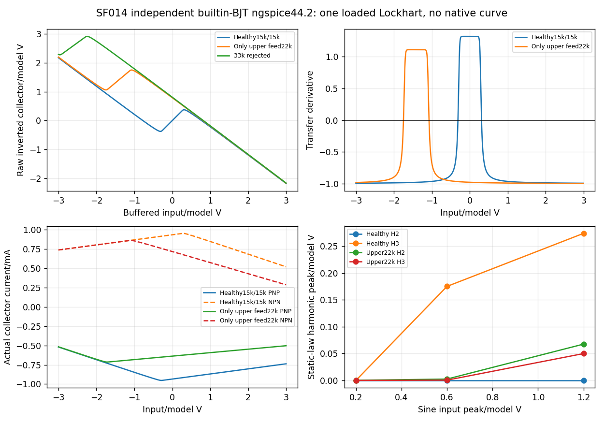

# SF014 — one loaded Lockhart cell, one upper-feed resistor drift

Experimental standalone Soundforge specimen for issue58. [Pre-DSP Gate0](SF014_GATE0.md)
and [ADR014](adr/ADR-014-lockhart-feed-resistor.md) record the selection before
native implementation. Main remains `c3aaca164e7a3f7d5b0106b3dd8dc89b7e1ef940`;
open42/48/56 were not merged/cherry-picked,57 is parked. No production DSP,
Engine, firmware, patch contract, storage, living sources or astrology changed.

One complementary transistor cell genuinely folds. Healthy transfer derivative
changes sign near−.31075/+ .31080modelV. Exactly one upper PNP feed resistor
changes15k→22kΩ; lower feed/load/rails/transistors and every filter stay identical.
Both fault turning points move negative:−1.74640/−1.07245V. Its raw readout DC
becomes+.793664972V, rather than an invented bias.33k was rejected because its
turning points−2.96065/−2.24290V fall outside the chosen guitar excursion.
The fault is mostly smoother/less folded at these input levels; it need not
be a more extreme fuzz. No synthetic gate, offset or one-sided transfer is added.



## Circuit and scope of fidelity

Literal SPICE [netlists](../tests/fixtures/wavefolder/netlists/) and the Gate0
schematic define the complementary PNP/NPN common-base-drive/shared-collector
Lockhart analyzed by Esqueda et al2017, DOI10.3390/app7121328.±15V supplies,
15kΩ feeds,10kΩ collector load, ideal buffered input and unity inverting readout.
Generic reciprocal Ebers–Moll IS1e-17A,BF100,BR1,T300K; finite base/reverse
currents are retained. These are model supplies, not Daisy codec voltage rails.
The independently chosen common output coupling is an isolated100nF/100kΩ
15.9155Hz RC. Reset precharges its physical DC state without moving the raw curve.

Both devices are nominal static laws, not a calibrated transistor pair. Intrinsic
charge/storage, Early effect, high injection, finite buffers/supply impedance,
noise, device spread and temperature dynamics are omitted. Recovery evidence
proves declared FIR/coupling history, not arbitrary transistor charge recovery.
This is a reduced physical circuit model, not physical hardware equivalence.

## Implementation and reuse

| Changed files | Purpose |
|---|---|
| `include/parable_wavefolder.h`, `src/parable_wavefolder.cpp`, `src/wavefolder_cell.h` | Fixed one-cell native processor, stopped nonlinear preparation and implicit derivatives; no generic solver |
| `tools/wavefolder_lab.cpp`, `wavefolder_stimulus.h` | Same native healthy/fault guitar, controlled WAVs and branch/DC/levels/full-process timing; optional unchanged RAT/Muff/CMOS comparisons |
| `tools/wavefolder_spice_reference.py`, committed fixtures/netlists | Independent built-in-BJT DC/current/load/rail and high-rate numerical references |
| `tools/wavefolder_study.cpp`, `wavefolder_study.py`, `wavefolder_plots.py`, `docs/data/sf014/*` | Reproduce solver/table/oversampling alternatives and retain actual results/plot |
| `tests/test_wavefolder.cpp`, `test_wavefolder_cli.py`, CMake | Scientific, boundary/guard, metadata, source-safety and actual listening-runner tests |
| `tools/check_wavefolder_arm.py` | Pinned actual M7 code/layout/calls/static frames; no target execution |
| `tools/wavefolder_evidence.py`, CI workflows | Exact-repeat attributed listening package and added ARM/sanitizer checks; existing jobs retained |
| `third_party/wavefolder/*`, registry, registry count test | Actual pinned sources, narrow MIT attribution, audio rights and truthful evidence categories;12assets |
| Gate0/ADR/report/figure/README/status | Reviewable decisions, results and limitations |

Borrow-first audit inspected actual pinned ACME.jl, LockhartWavefolderJUCE,
portedplugins LockhartCell and Buchla MATLAB sources/licenses. Only the MIT ACME
transport/terminal-current/derivative foundation is narrowly adapted. The
unlicensed/GPL alternatives are audit-only; no GPL/unlicensed coefficients or
artwork imported, and MIT/BSD-2 import policy is unchanged. Full source pins,
relationship and licenses are in [provenance](../third_party/wavefolder/provenance.json).

Reuse is concrete:6 unchanged laboratory components—PCM reader/writer, analysis,
excitation, callback guard, SPICE wrapper, take03 preparation—plus owned main FIR/
FFT patterns. The host comparison links3 existing native models unchanged.
No claimed percentage or saved engineer-hours is inferred from line counts.

## Numerical results and selected cost tradeoff

Independent ngspice44.2 built-in BJTs supply3603DC rows (including rejected33k),
744load/rail rows (1/5/10/50kΩ,±12/15/18V),12static amplitude/bias harmonic cases
(.2/.6/1.2V and0/.1V bias), and24full-wave cases at44.1/48/96kHz. Reference
generation imports no native model, table, solver or captured output.64x→128x
temporal refinement≤2.60e-10 normalized units; halving DC grid step.1mV→.05mV
changes≤5.24e-10. Tests authenticate data, literal netlists and generator hashes.

Direct native versus SPICE peak node error.289µV, collector-current error.348nA.
On committed DC probes the interpolated curve peaks2.772µV error and actual
interpolated-collector KCL3.688nA; the emitter states are independently re-solved
at that collector, rather than mislabeling exact-solver KCL as interpolation KCL.
Fold-location error≤45.5µV. Full dense selection sweep peaks3.685µV healthy /
2.537µV fault, under20µV gate. Primitive derivative matches the actual rounded
cubic. Harmonic amplitudes/DC/RMS are independently checked, not native goldens.

Accurate stopped solve versus short4/8/16-update alternatives,256/512/1024
intervals, symmetric Lambert-W and1x/2x/4x with/without ADAA were measured.
[Full144-case selection](data/sf014/selection.json), [full-path costs](data/sf014/cost.csv)
and [cold solver failures/costs](data/sf014/direct.csv) retain the alternatives.
The paper's symmetric idealized analytic law differs~3.883mV from this full
finite-beta law; that is not a paper error or permission to bias-shift it for
an unequal-resistor fault.512intervals use8208lookup bytes;256fails the20µV
gate and1024doubles lookup without a useful error-budget improvement.

Normal playback is4x+first-order ADAA with193tap FIR, bounded to386resampling
tap products/frame and≤8curve/primitive evaluations plus4ADAA divisions.
Worst high-guitar~3520Hz relative RMS error.7365%, harsh~8k3.793%, busy chord
.1074%,1760Hz.2722%. The fixed coherent tones use actual floor FFT bins, never
rounded labels. Worst unwanted-tone spur−60.80dBr **total reference RMS**, not
fundamental dBc (a legitimate fundamental can null).4x without ADAA improves
RMS error (.1922%/2.201%) but leaves spurs−54.17/−31.06dBr. ADAA trades waveform
error for lower aliasing; no universal perceptual proof is claimed. Only its
known half-internal-sample delay is aligned; no fitted phase/gain.1x/2x fail
the selected high-note gates. Chord error uses the full independent reference,
not a false pure-tone harmonic mask. Runtime196/1318Hz nominal guitar
fundamentals at Drive1/3/6 are separately printed at all three rates; the low
note's actual native harmonics are checked against independent SPICE amplitudes
after the common coupling response. Actual coherent frequencies are recorded.
The1.76/3.52/8kHz probes remain separate, more demanding alias stress tests.

Accepted Drive0…6 and input±.25modelV give an all-history interpolation L1 bound
<2.968V at the cell, below the±3V table domain (including float rounding margin).
Outside-domain input containment is counted. Ordinary renders have zero invalid,
input/table/output clamp or numerical-failure counts. Callback guard checks
allocation/free/IO/locks; ARM calls confirm no solver/exp/log/prepare/exception
path. Rejected preparation/Drive preserve previous history; invalid samples
return zero without advancing history; reset, stop, silence, recovery, extremes,
rate/factor/AA endpoints and valid dynamic Drive are tested. No clickless or
concurrent editing promise is made; the class has one stopped/preparing owner.

## Actual listening files and musical limits

CI artifact **parable-wavefolder-auditions** contains69WAVs:67native renders plus
the full original stereo24 take and the unchanged20s mono16 prepared source.
CC-BY4.0 attribution, all5authors, original/archive/prepared SHA256 and exact
transforms travel with it. [Audio notice](../third_party/wavefolder/AUDIO_NOTICE.md).
The exact Centaur/tape Guitar-TECHS Player3 take03 is reused, not a more favorable
recording. This source permission is not a global Parable code license.

Input peak.2modelV (gain .6461841845789785 for this exact prepared file),
Drive1/3/6 gives restrained/medium/intense. Output is common volts/8; musical
files add.2s tail. Dry is calibrated input/8. `raw` means no offline level gain,
still including ordinary filters/ADAA/coupling. `common` preserves loudness
changes within each dry/healthy/fault triple. Separately labeled `rms_matched`
uses individual, disclosed gains≤16; not LUFS or equal-gain comparison.
Receipts describe pre-PCM native float levels; tests also measure the delivered
PCM16 WAV RMS/peak against those receipts within one quantization step.

| Drive | Healthy raw RMS/peak | RP22k raw RMS/peak |
|---|---|---|
|1|.0060945/.032580|.0045102/.024053|
|3|.0177020/.050912|.0135248/.071529|
|6|.0272608/.058806|.0269962/.130514|

All listening files remain below full scale without output containment. Fault
crest grows at intense drive while its mean AC output returns to near zero.
The sampled128-frame state trace crosses healthy turnover0%/1.08%/15.47% of
the three guitar conditions, but the fault's first negative turnover only~.027%
at intense. These are decimated observations, not exact occupancy statistics.
The fault can sound comparatively conventional/smooth at lower guitar levels;
we retain that causal outcome. Raw DC/current/ADAA/filter/output taps remain
in `state.csv`, not hidden by the playback high-pass. `spectrum.csv` has a
declared8192point Hann slice; do not call that single slice whole-song analysis.

Start `medium_{dry,healthy,RP22k}_common.wav`, then RMS matches and all three
drive conditions; intense is the principal healthy folding audition. Synthetic
attacks/sustain/chord/sweep/two-tone are separate. `compare_*` uses the exact
same phrase and2s tail through WavefolderDrive3 and unchanged RAT/Muff/CMOS
at their .5controls. Model scales differ (volts/8,/4,/9,/4); RMS matching
does not pretend equal electrical gain or tone settings.

Structural/sonic comparison: RAT's diode clipping/filter and Muff's cascaded
transistor/diode gain and tone network compress peaks. CMOS inverter gain/
feedback bends toward its supply limits. Lockhart's measured derivative reverses,
so increasing peak input can reduce and then invert output; it has no added fuzz
tone stack or manufactured sustain/envelope. One cell retains attack/volume
dependence, with restrained drive mostly linear and higher drive creating
nonmonotone harmonics. In this exact guitar medium comparison it is much more
restrained than the other three; metallic/alien character is a hypothesis for
founder listening, not a label established by a waveform plot. No human musical
audition or founder approval is claimed. If judged thin/harsh/too restrained,
the next smallest proposal is a separately reviewed small input/voicing study,
not extra effects or a forced sitar envelope.

## Resource evidence and reproduction

Actual pinned xPack GCC14.2.1-1.1 M7 hard-float/O2 object:3904text,0data/0BSS;
full instance9704bytes (includes8208lookup). Static frames:process64,sample72,
curve64bytes:200bytes known deepest callback chain, excluding caller/interrupts/
ABI effects. Stopped prepare9944bytes plus its own callees; not callback work.
Whole object imports sin/cos/tan/expm1/memory for preparation/reset, while actual
audio calls are only process→sample→cellCurve, using hardware floating operations.
Engine11040/bundle11288/Runtime45224bytes remain unchanged. Firmware is unchanged
and the wavefolder is not linked/admitted there. Existing ARM CI still builds
the old images; a successful object/link does not demonstrate boot or audio.
The object measurement excludes separately linked libm/library costs; there is
no newly integrated wavefolder firmware image or measured incremental link size.

Recorded same-native full-processor Linux x86_64/GNU14.2 timings:per-render CPU
.4220… .6116µs/frame, wall .4236… .6116µs/frame on a contended host, excluding
preparation, files and analysis. Exact per-condition frames/costs are in
`performance.csv` and [this local snapshot](data/sf014/guitar-performance.csv);
earlier contended runs reached1.5686µs wall time. These are measurements, not ARM estimates. No microbenchmark
of eliminated functions is substituted for full-processor cost.

Conditional planning ceiling10000cycles/baseframe:386taps×12 +8curves×180
+4divisions×32 +3800loop/control/RC allowance. Assumes cached code/data and no
interrupt/DMA/memory stalls, **not a certified WCET**. Seed3 cycles/deadline,
runtime stack/cache, physical circuitry and audio are **not measured**. Future
2000cycle admission is unproven;96k feasibility cannot be inferred from host timing.

From clean checkout (CMake≥3.15,C++17,Python≥3.9; JSON download SHA pinned):

```sh
cmake -S parable-starter -B build-debug -DCMAKE_BUILD_TYPE=Debug
cmake --build build-debug -j2
ctest --test-dir build-debug --output-on-failure --no-tests=error
cmake -S parable-starter -B build-release -DCMAKE_BUILD_TYPE=Release
cmake --build build-release -j2
ctest --test-dir build-release --output-on-failure --no-tests=error
cmake -S parable-starter -B build-asan -DCMAKE_BUILD_TYPE=Debug -DCMAKE_CXX_FLAGS="-fsanitize=address,undefined -fno-omit-frame-pointer -fno-pie -O1" -DCMAKE_EXE_LINKER_FLAGS="-fsanitize=address,undefined -no-pie"
cmake --build build-asan --target parable_wavefolder_test parable_wavefolder_lab -j2
ASAN_OPTIONS=detect_leaks=1:halt_on_error=1 UBSAN_OPTIONS=halt_on_error=1 ctest --test-dir build-asan --output-on-failure --no-tests=error -R '^wavefolder_'
```

Baseline before edits:36/36 Debug1450.69s,Release264.12s. Post-implementation
regression:38/38 Debug2489.81s,Release296.35s. After final affected test/metadata
additions,Debug2/2 (34.41s),Release2/2 (5.05s),ASan/UBSan2/2 (32.64s).
Final CI results are recorded
in the PR and downloadable `HOST_TESTS.txt`; existing sanitizer/concurrency jobs
remain enabled.389old DSP/firmware/fixture hashes and27canonical/living rendered
outputs are unchanged; existing16LabRAT output goldens remain mandatory.
Downloaded ARM CI also preserves every prior56object/14firmware-binary payload
byte-for-byte against the previous main build. The known fuller internal-flash
overflow is still reported by the unchanged firmware recipe, not hidden or repaired.

ARM:use existing `firmware/build.py` to obtain exact pinned toolchain, then
`python3 parable-starter/tools/check_wavefolder_arm.py --compiler PATH/arm-none-eabi-g++ --output build-arm/wavefolder-audit`.
For offline independent regeneration install **NumPy2.3.5**, obtain SHA-pinned
ngspice44.2 package from the manifest, then:

```sh
python3 parable-starter/tools/wavefolder_spice_reference.py --ngspice PATH/ngspice --work spice-work --output regenerated --check-existing parable-starter/tests/fixtures/wavefolder
./build-release/parable_wavefolder_study native-study
python3 parable-starter/tools/wavefolder_study.py --captures native-study --spice-work spice-work
python3 parable-starter/tools/wavefolder_plots.py
```

Plots additionally use Matplotlib3.10.8; neither research package is a DSP/build
dependency. Primary WAV reproduction uses unchanged `tools/klon_input.py` and
`parable_wavefolder_lab --input take03-20s-mono16.wav --output auditions --compare-existing`.
CI has full source/download commands and runs the entire native renderer twice,
requiring byte identity of every output except timing-only `performance.csv`.
Artifact checksums bind source, reference, notices, data and69WAVs to its commit.

Remaining gates:independent review, founder listening and physical/target
calibration/runtime performance. No such gate is satisfied by these numerical
tests. Next smallest ticket:founder audition of the supplied three-drive pairs;
if selected, a separately scoped measured Seed3 admission study.
