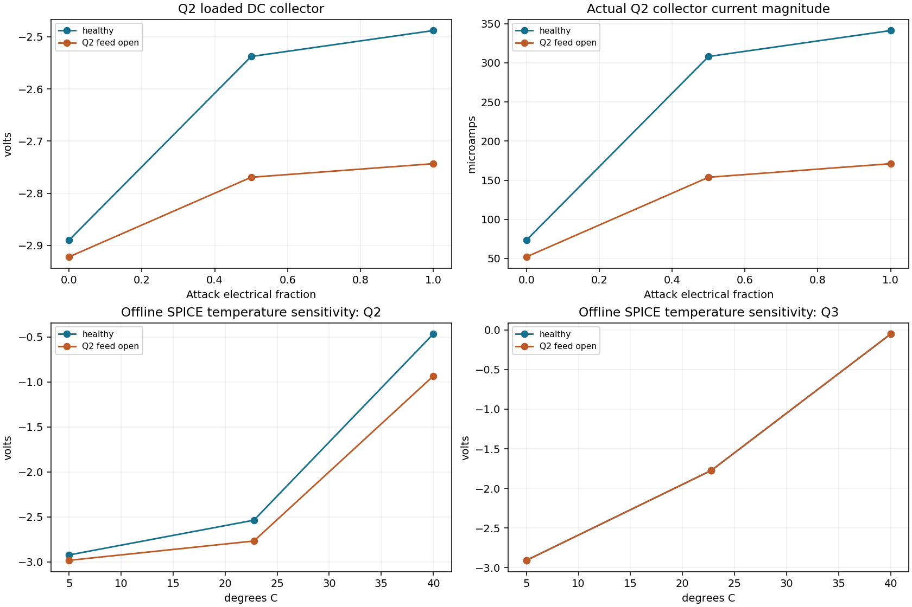
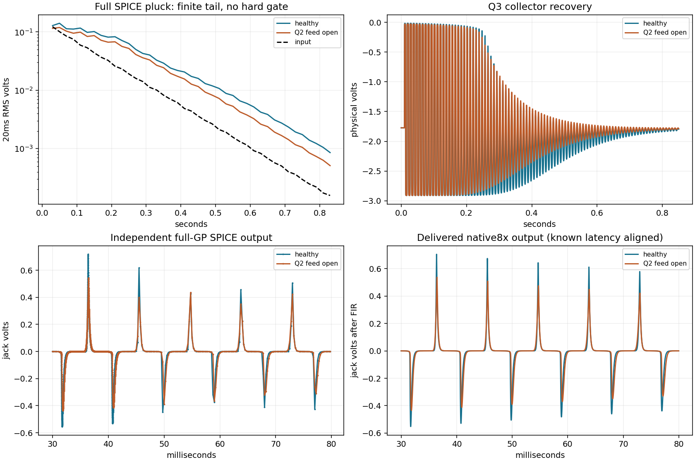
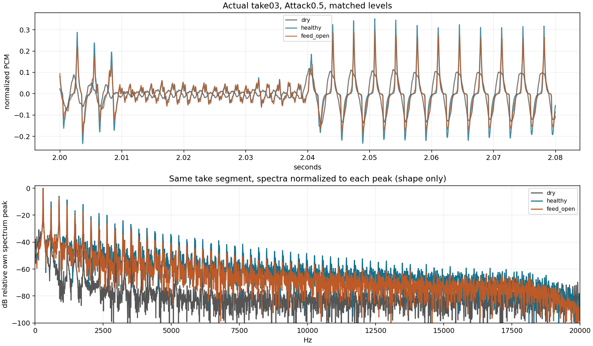

# SF-015 — original-FZ-1-style three-germanium fuzz

**Experimental; not ready for fidelity or runtime admission.** One native3PNP
circuit and one physically open Q2 bias-feed resistor, with actual same-take guitar
WAVs. Electrical/implementation regressions pass. The original full-band sampling
gate **fails12/24 cases**, and abrupt healthy gating is **not demonstrated**. No
threshold was relaxed. Founder listening, empirical2N270 agreement and Seed3
execution remain unproved. See [Gate0](SF015_GATE0.md),
[ADR015](adr/ADR-015-original-fz1.md) and [work log](SF015_WORK_LOG.md).

Listening: [research release](https://github.com/amstarhd-dev/parable/releases/tag/sf-015-listening-v1)
from the unmerged review branch. Start `attack_mid_dry_common.wav`,
`attack_mid_healthy_common.wav`, `attack_mid_feed_open_common.wav`, then the two
`*_rms_matched.wav` versions. Release publication is separate from merging or
shipping firmware. Source/kernel identities and checksums accompany the files.

## Scope and implementation

Original3V positive-ground FZ1 topology; **measured AC128 template**, not a measured
2N270 specimen or authentic vintage unit. Q1 emitter follower, Q2 Attack/bias
clipper, Q3 second clipper;10n input,20µF/20µF coupling,3.3n output with actual56k
**shunt**, loaded500k Volume and1M amplifier. Full netlist/contradictions are in
Gate0. Attack is electrical rheostat fraction, not calibrated knob rotation.
Default source1k, battery−3V, Attack/Volume.5, effectiveVt25.5mV (about22.77°C).

The two-junction GP evaluator is reused **unchanged** from main. Finite beta,
reciprocal conduction, saturation, Early/high-injection and separate leakage terms;
constant100pF CBC, CBE0 and finite RB/RE/RC. Omitted: nonlinear charge/storage,
noise, self-heating, electrolytic ESR/leakage and calibrated device spread. Exact
current-law agreement does not validate those omitted physical effects. The measured
template does not empirically calibrate this complete3V circuit or its parameter
accuracy throughout the supported numerical domain. Exact passive elimination produces one fixed
six-port solve with four external and three intrinsic capacitor histories. Terminal
resistances use ACME's2×2 port relation. Stopped preparation solves DC; runtime
translates about that operating point without discarding nonlinear memory.

Normal playback is **8x,385-tap Blackman interpolation/decimation**, selected after
4x failed the false-spur gate.2x/4x remain numerical comparison modes;1x permits
up to1.536MHz for a16x offline reference, not an audio-hardware capability claim.
The nominal FIR group delay is48 base frames:1ms at48k, excluding the circuit's
frequency-dependent response and any hardware latency. Neither the GP equations
nor original circuit values changed when sampling increased.

Every internal solve allows24 Newton updates with at most8 bounded domain retries
per update. Conventional junction-voltage limiting is used. A monotone residual
line search was rejected after it stalled this stiff system; it is not evidence
of an analog malfunction. Failed solves reset/precharge and count an error;
**all published auditions require zero failures/containment in both render passes**.
No synthetic gate, envelope, random sputter, noise generator or runtime makeup gain.

No Engine/patch/correspondence/storage/activation/firmware changes.427 pre-existing
DSP/header/firmware/fixture files match the baseline hashes in
[data/sf015/preservation.json](data/sf015/preservation.json). Registry count12→13
is inventory, not a count of finished or hardware-admitted effects.

## Independent electrical validation

Pinned ngspice44.2, Debian44.2+ds-1 package SHA256
`4d76721dd91416055b1088cfc58626d4db47b91afda7c73258c0968ba6e4d24e`.
Two references implement the same declared component facts independently:

1. Built-in PNP GP, measured germanium constants, declared temperature/terminal R.
2. Explicit published GP current sources in SPICE MNA, with physical internal
   nodes and capacitor integration. No native function or solver imported.

**Reference discrepancy is retained:** exact44.2 source was inspected, including
its deeply reverse-biased cubic continuation. The built-in model is not exactly
`expm1` there. Across54 DC conditions it misses the predeclared2µV node gate by up
to**7.7869mV** (current difference up to.7779µA). This is not silently called a pass.
The separate full-exponential MNA reference agrees within**6.79nV**, terminal
currents**4.53pA**; native DC KCL residual≤**4.07e−19A**. Derivative finite-difference
peak absolute error**3.23e−11A/V**, within the predeclared mixed tolerance.

SPICE's tiny fitted1.727µΩ collector resistance caused numerical stiffness. The
explicit-equation reference uses an ideal short there, and two problematic built-in
transients do likewise. Native always retains the finite resistance. At1mA the
omitted drop is1.727nV; actual conditions/current records are supplied. This is a
reference-conditioning approximation, not a second faulty component. RB/RE and
CBC remain present. Two early aborted built-in runs were rejected; generation
now verifies the complete time span before interpolation, preventing extrapolation
from an incomplete simulation. Full-transient process deadline300s is bounded;
the original shared90s wrapper timed out under this two-CPU host's contention.
The shared RAT helper/source was preserved; its small process wrapper was adapted
locally, without borrowing RAT electrical equations.

Coverage:

- 54 DC conditions/reference: both feed states, Attack0/.5/1, rail magnitudes
  2.7/3/3.3V and ISC×.5/1/1.5. Separate5/nominal/40°C **offline** sensitivity;
  thermal law is an assumption, not measured vintage temperature calibration.
- 18 transient conditions/reference:110Hz pluck/decay at three Attack values,
  196Hz input peaks.02/.1/.2V,10k-source/100k-load, and Volume0/1. Both reference
  implementations yield36 comparisons, including the full.85s pluck history.
- 192k native direct comparison: uniform4k checkpoints across the complete history
  **and**2049 full-rate samples spanning a complete110Hz cycle near sharp clipping.
  The whole-history and dense-cycle RMS gates are checked separately with the same
  thresholds (2% +20µV jack;2% of AC RMS +.5mV per node). All pass. Worst whole-grid
  jack relative RMS error across both references**.18992%**. Sparse checkpoints
  alone are not represented as a continuously sampled audio RMS measurement.
- Source/load are real finite terminals. This is a Thevenin-source test, not a
  calibrated inductive pickup/cable/guitar-volume-pot model. Volume rollback in
  the audition changes input amplitude, and does not claim complete pickup loading.




The waveform display retains sparse checkpoints outside its dense cycle; outer
pulse maxima can be undersampled visually. Numerical dense-cycle checks use the
full grid. Native normal playback includes its disclosed FIR; the192k direct
physics comparisons use1x and no FIR. These are distinct measurements.

## One causal failure and the musical limit

Only470k feed from negative rail to Q2 base is disconnected. Same transistor
parameters, temperature, supply, source/load, Attack/Volume, kernel and gains.
At nominal Attack.5:

| Quantity | Healthy | Open feed |
|---|---:|---:|
| Q2 base, physicalV |−.0739424 |−.0525849 |
| Q2 collector,V |−2.537841 |−2.769318 |
| Q2 collector-current magnitude,µA |308.106 |153.788 |
| Q2 base current,µA |−.90687 |+3.78251 |
|470k-feed current magnitude,µA |6.22565 |0 |

Q1 and Q3 **DC** do not change: ideal interstage capacitors block DC. Q3 transient
bias/conduction does change through C3.1M/2.2M drift candidates were less clear;
open was selected independently before native DSP, rather than altering more parts.

Same-take comparisons show roughly.8–4.7dB RMS loss depending on input/Attack.
A best-fitting single output fader still leaves about17–26% relative waveform
RMS residual (actual values in `fault-shape.csv`). The difference includes waveform
and decay changes. Windowed196Hz SPICE harmonic fits quantify H2/H3/H5 changes;
these are dynamic.07–.12s measurements, not a claim of steady-state or measured
pedal THD. Raw node/current/capacitor traces remain available. Trace input is the host-frame
sample; node values are the last internal phase, and instant jack is before the
output decimation FIR.

**The hoped-for abrupt healthy gating is not demonstrated.** Both this measured
AC128-template healthy circuit and its fault have a smooth finite low-level tail.
A threshold that turns the waveform off was not found in the pluck probe. PCM16
quantization zeros at very low levels are not an electrical gate. This increment
therefore does **not** establish that part of the musical brief. Founder listening
must decide whether this less-gated voice is useful; empirical2N270 evidence would
be a better next step than adding a fake gate or tuning to three underidentified
patent DC numbers. No claim about an actual *Happiness Is a Warm Gun* pedal setup
is made; that is a founder tonal association, not verified recording provenance.

## Sampling gates: passed spurs, failed full-band waveform criterion

Same complete processor:1x/2x/4x/8x,44.1/48/96k, both feed states, coherent≈1.76,
3.52,8k and a multi-partial chord.16x exact native reference is independently
ideal-bandlimited in the offline analysis; SPICE independently checks the circuit
physics. This high-rate comparison is not a measured physical transistor.
No phase fitting: declared48-frame FIR delay is removed analytically.

| Sampling | Combined original gates passed | Worst unwanted spur,dB/reference RMS |
|---|---:|---:|
|1x |6/24 |−7.09 |
|2x |9/24 |−20.32 |
|4x |10/24 |−33.34 |
|**8x** |**12/24** |**−48.48** |

At8x, **all18 pure-tone false-spur checks pass** the−45dB limit. Full-band RMS
still misses12/24 predeclared5% (8k:10%) limits, worst**30.05%**. The declared
FIR removes near-Nyquist harmonics, especially the≈24k third harmonic at48k. The
separate explanatory comparison including that known output FIR has maximum
**.4292%** relative error. That diagnostic does **not** replace or relax the original
gate. All24 rate/state/excitation comparisons and detailed rows are in `alias.csv`.

`fz1_alias.py --require-gates` actually returns**1**. The dedicated CI scientific
job is intentionally enforcing the original gate, without `continue-on-error`.
A bandwidth/fidelity acceptance decision remains open. Do not infer overall
scientific acceptance from the narrower registry `host_numerical: passed` scope.

## Actual audio and host resource measurements

102 native PCM16 WAVs, plus the full original stereo24 and prepared mono16 sources:

- Three Attack fractions.1/.5/1 at identical.2V input peak; three input levels
  .02/.1/.2V at identical Attack.5. Dry/healthy/fault, raw/common/individually RMS
  matched:54 WAVs,20s same **Guitar-TECHS Player3 take03** +2s natural tail.
- Owned pluck, held note, rolled-back amplitude, hard attack, chord, two-tone:
  dry/healthy/fault raw/common:36 WAVs. Synthetic, not recorded guitar.
- Same take/calibration through FZ1, existing two-transistor germanium, four-transistor
  Muff, RAT, CMOS and dry; raw/RMS:12 WAVs. Controls.5; differing topology/gain/filter
  explain that this is a listening comparison, not a superiority ranking.

Raw FZ1 and dry are volts/4; no per-voice runtime compensation. Common gains are
identical **within each triple**. RMS matching has disclosed individual gains and
is not LUFS/perceptual matching or cross-preset equal loudness.16x maximum offline
gain and.9 target peak prevent clipping. `renders.csv` records pre-PCM RMS/peak/DC,
gains and final levels; CLI tests decode actual delivered PCM within one quantizer
step. Each rendered float output is reset and processed again through the same
C++ kernel and required exactly equal. Both passes require zero numerical failures,
input/output containment and invalid samples.

Timed complete8x processor repeats, including FIR and all nonlinear solves:
**5.148–10.744 CPUµs/base frame** across the rendered conditions on this GNU14.2
Linux host. These are actual host measurements, not target estimates. Detailed
wall/CPU times and sampling alternatives are committed. Maximum observed audition
solver evaluations/internal sample8, mean1.687–3.156. No claim that a host average
is a target WCET or that all possible inputs are covered.

The raw capture's derived trace-time field originally retained the4x phase3/4
anchor after switching to8x. It was corrected to phase7/8 by frame index; the host
runner now emits that value directly. No WAV, voltage, current or gain was changed.
`trace-time-receipt.json` records both hashes and producing source/binary identity;
the producing source is preserved at native commit1120ec2. Packaging source HEAD
and unchanged DSP component hashes are recorded separately. This is a metadata
correction, not an audio edit.



Full [audio attribution](../third_party/fz1/AUDIO_NOTICE.md) accompanies every
package. Exact prepared source SHA256
`75ae5e73c72e6774fb75e6318dc91ba66347fb65290949e947144033eb648f52`.
No recorded commercial song or upstream simulator audio is redistributed.
Human/founder audition approval: **not performed**.

## ARM evidence and practical limits

Actual pinned xPack GNU Arm14.2.1-1.1, Cortex-M7/thumb/fpv5-d16/hard ABI,
`-O2 -fno-exceptions -fno-rtti -fno-fast-math -fno-finite-math-only`.

| Measured item | Result |
|---|---:|
| Unlinked FZ1 object text |7720B |
| Object data/BSS |0/0B |
| Complete processor instance |5136B |
| Existing Engine/bundle/Runtime |11040/11288/45224B, unchanged |
| Compiler local frame: process/sample/solve/evaluator/device |72/512/1032/224/104B |
| Stopped prepare frame |5480B |

Resolved local calls **and** relocations were inspected, not relocations alone.
Callback reaches GP/expm1/square-root and bounded memcpy/memset; trig/preparation
are outside it. No indirect calls, allocator, exception, lock, IO or atomic helper
appears in the audited callback graph. The known callback-frame sum is1944B
**before libm/caller/interrupt frames**; it is not a measured stack high-water.
Stopped preparation also needs a separate control-stack budget beyond its5480B
frame. No target stack fit or real-time admission is inferred.

Eight internal samples, at most193 circuit evaluations/sample; each evaluates
three GP devices (12 exponentials and three square roots). FIR performs770 taps/
base frame. Bounded work is not a deadline guarantee. The future2000-cycle/sample
admission ceiling is **not demonstrated**. No calibrated ARM cycle estimate is
supplied; compiler instruction/static-frame evidence is not physical timing.

This assignment compiled/audited the standalone object, **did not link FZ1 into
firmware**, and made no firmware source/linker/bootloader change. Existing ARM
workflow remains, with this additional audit step. Actual Seed3 audio, cycles,
latency, analog levels/noise, cache behavior, interrupts, stack high-water, boot and
hardware component fidelity: **not tested**.

## Build, tests and reproduction

CMake3.31.6, GNU14.2.0, Python3.12.14 here. Default CMake fetch verifies pinned
nlohmann-json3.11.3 archive SHA; this environment reused its existing source cache
using `-DFETCHCONTENT_SOURCE_DIR_NLOHMANN_JSON=/workspace/work/sf015-deps/nlohmann_json-src`.
From repository root:

```bash
cmake -S parable-starter -B build-debug -DCMAKE_BUILD_TYPE=Debug
cmake --build build-debug -j2
ctest --test-dir build-debug -j2 --output-on-failure --no-tests=error
cmake -S parable-starter -B build-release -DCMAKE_BUILD_TYPE=Release
cmake --build build-release -j2
ctest --test-dir build-release -j2 --output-on-failure --no-tests=error
```

Before editing: Debug38/38,2439.85s; Release38/38,258.38s. After implementation:
full Debug40/40,2613.06s; final full Release40/40,199.05s. Strengthened final affected
Debug2/2,492.13s, verifies the dense-cycle/boundary additions and receipt-time fix. Explicit native electrical/
safety execution reports789,690 checks. Existing golden checks remain unchanged.

```bash
cmake -S parable-starter -B build-asan -DCMAKE_BUILD_TYPE=Debug \
  -DCMAKE_CXX_FLAGS="-fsanitize=address,undefined -fno-omit-frame-pointer -fno-pie -O1" \
  -DCMAKE_EXE_LINKER_FLAGS="-fsanitize=address,undefined -no-pie"
cmake --build build-asan --target parable_fz1_test parable_fz1_lab -j2
ASAN_OPTIONS=detect_leaks=1:halt_on_error=1 UBSAN_OPTIONS=halt_on_error=1 \
  ctest --test-dir build-asan --output-on-failure --no-tests=error -R '^fz1_'
cmake -S parable-starter -B build-tsan -DCMAKE_BUILD_TYPE=Debug \
  -DCMAKE_CXX_FLAGS="-fsanitize=thread -fno-omit-frame-pointer -fno-pie -O1" \
  -DCMAKE_EXE_LINKER_FLAGS="-fsanitize=thread -no-pie"
cmake --build build-tsan --target parable_activation_test parable_living_test -j2
TSAN_OPTIONS=halt_on_error=1 ctest --test-dir build-tsan \
  --output-on-failure --no-tests=error -R '^(activation|living)_(contract|concurrency)$'
```

Final affected ASan/UBSan2/2,576.23s; existing activation/living TSan4/4,137.87s.
The subsequent host receipt-time-only arithmetic fix was verified by final Release
and focused Debug CLI; no DSP operation changed. Broader unchanged integration
sanitizer jobs are preserved, not claimed as locally
rerun. Host full suites cover every existing automated test. GitHub Actions on main
failed at startup before checkout/build/test; no independent remote test pass is
claimed. Owner must restore job startup. PR run links/outcomes are in the PR body;
no account or unrelated CI configuration was changed.

Reproduce scientific evidence (offline NumPy2.3.5, plots additionally
Matplotlib3.10.8; host tool only):

```bash
python3 parable-starter/tools/fz1_spice_reference.py --ngspice /ABS/PINNED/ngspice \
  --output reference-builtin --fixtures parable-starter/tests/fixtures/fz1
python3 parable-starter/tools/fz1_equation_reference.py --ngspice /ABS/PINNED/ngspice \
  --output reference-equations --fixtures parable-starter/tests/fixtures/fz1
./build-release/parable_fz1_study sampling-study
python3 parable-starter/tools/fz1_alias.py --study sampling-study \
  --fixtures alias-replay --require-gates
# Last command exits1: retain/report the12 original full-band misses.
python3 parable-starter/tools/check_fz1_arm.py \
  --compiler /ABS/PINNED/xpack-arm-none-eabi-gcc-14.2.1-1.1/bin/arm-none-eabi-g++ \
  --output fz1-arm
```

The ngspice Debian binary pin, exact44.2 source archive and simulator/netlist/fixture
hashes are recorded in `third_party/fz1/` and fixture manifests. Actual emitted
netlists/logs accompany the download; no copyrighted schematic image is copied.

```bash
curl --fail --location https://zenodo.org/api/records/14963133/files/P3_music.zip/content --output P3_music.zip
python3 parable-starter/tools/klon_input.py --archive P3_music.zip --output guitar-input
./build-release/parable_fz1_lab --input guitar-input/take03-20s-mono16.wav \
  --output fz1-auditions --compare-existing
python3 parable-starter/tools/fz1_report.py --renders fz1-auditions \
  --study sampling-study --output fz1-report
python3 parable-starter/tools/fz1_evidence.py --renders fz1-auditions \
  --input guitar-input --tests build-release/Testing/Temporary/LastTest.log \
  --arm fz1-arm --netlists reference-builtin --netlists reference-equations
```

## Changed files and next smallest decision

`include/parable_fz1.h`, `src/parable_fz1.cpp`: one fixed portable circuit.
`CMakeLists.txt`, two test files and new fixtures: standalone build/physical/safety/
audio checks. `tools/fz1_*` and `check_fz1_arm.py`: independent references, complete
processor study, strict acceptance check, real audio/receipts/figures and M7 audit.
`third_party/fz1/`: source/license/audio accounting. Gate0/ADR/report/work log,
measured data/figures/status and registry/tally: reviewable claims. Workflows add
only this specimen's audio, sanitizer, scientific and object checks; older jobs
remain intact. No other effect algorithm or production contract changed.

**Next:** founder listens to the healthy/fault pairs and decides whether this
less-gated measured-template voice satisfies Cancer. If not, obtain empirical2N270
or real original-FZ1 evidence before further model tuning. Separately approve or
reject the disclosed anti-alias bandwidth; do not quietly edit the original gates.
Resolve those decisions and measure actual target cost before any Engine admission.
