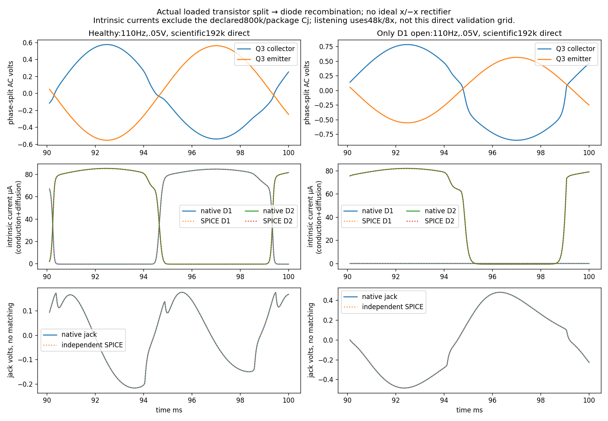
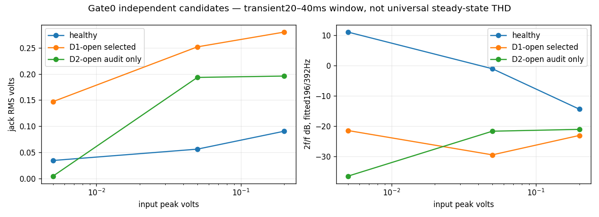
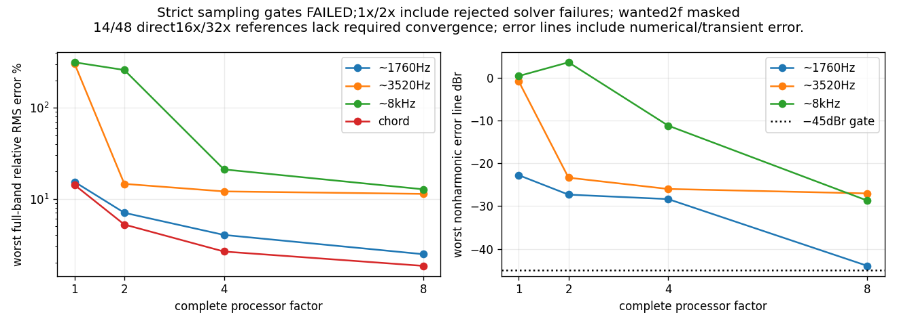
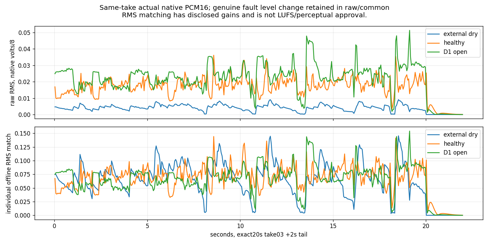

# SF-016 — documented original-style Fender Blender

**DRAFT research; scientific acceptance failed.** One native five-transistor,
four-germanium-diode Blender and exactly one physically open octave rectifier D1.
Actual same-take healthy/fault WAVs exist, with complete level/source receipts.
The strict8kHz transient gate misses21 field checks in two conditions;8x passes
28/48 combined sampling gates, and14 fine references lack required convergence.
No threshold was weakened. This is not production, vintage-unit or target admission.

[Gate0](SF016_GATE0.md) precedes code; [ADR016](adr/ADR-016-original-blender.md)
records the choice/tradeoffs. Listening: [research release/source ZIP](https://github.com/amstarhd-dev/parable/releases/tag/sf-016-listening-v1), with actual WAVs under `soundforge-auditions/sf016/`. Release binary uploads are unavailable in this environment; the tagged artifact branch supplies the standard GitHub source ZIP, with no merge. Start
`input_sustain_mid_b100_boost0_{external_dry,healthy,D1_open}_common.wav`, then the
healthy/fault `rms_matched` versions. Founder listening is a separate pending decision.

## What was implemented

Documented original-style four-knob signal circuit, original loaded SPDT bypass
and Tone Boost switching. Q1/Q2 gain/bias feedback, loaded10k Sustain/680ohm
internal dry tap, real Q3 collector/emitter splitter, individual10uF couplings,
D1/D2 recombination/loading, Q4 gain/D3/D4 clipping, loaded Tone/Level, Q5 make-up
and passive100k Blend. The internally amplified/attenuated dry tap is distinct
from the included external DI. No ideal x/−x splitter, post-hoc rectifier, pitch
oscillator, generic shaper, ideal crossfade, random malfunction or hidden makeup.

[Own connectivity schematic](figures/sf016/schematic.svg), its DOT source and
literal [healthy](../tests/fixtures/blender/nominal.cir)/[D1-open](../tests/fixtures/blender/D1-open.cir)
netlists make each part/polarity explicit. No historical artwork is redistributed.
Schematic Heaven's factory-style1015 list,1995 redraw and independent build sources
resolve1.5k/680ohm/25k/2.7nF and the redraw's reversed Sustain/Blend labels. In the
retrieved redraw, the emitter actually reads1k5; do not repeat another site's15k
description. The680k listing cannot be settled by DC because C3 blocks DC; actual
AC control range and corroborating drawings support680ohm. No individual1968 unit
was authenticated. Later three-knob/JMK six-transistor/Shields circuits excluded.

Fourteen nonlinear junction ports follow exact stopped passive elimination of
one fixed31-node circuit. All16 signal caps,10 declared BJT caps and4 diode
junction caps retain histories; diode diffusion charge is nonlinear. Ideal9V
supply makes its10uF C16 constant/zero AC, rather than inventing sag. BDF2 companions,
DC-relative coordinates, bounded32-update Newton with fixed pivoted elimination;
stopped DC budget160. No runtime allocation, IO, locks, exceptions or unbounded
iteration. Invalid preparation preserves the working object. Bad audio is bounded/
counted; failed solves precharge/reset and count numerical failure, never fault tone.

Source/version/units/omissions are in [provenance](../third_party/blender/provenance.json).
MIT ACME current/derivative foundation via main's Muff; nominal silicon EM,
BF350/BR4/IS1e-14, constant CBC4pF/CBE20pF. These are declared2N3391/A-like
assumptions, not a measured manufacturer card or vintage sample.1N276 named-model
transcription supplies .56uA/32V−1/800k shunt and capacitance; its diffusion
coefficient130ns/V implies **TT4.0625ns**, not130ns. Constant zero-bias depletion
~.58pF approximates its small voltage-dependent depletion. Half/double capacitance
sensitivity is retained. Early/high injection, nonlinear BJT charge, terminal R,
noise, heating, electrolytic defects and calibrated component spread are omitted.
Thermal/supply/source/load sweeps are assumed model laws, not empirical calibration.

Existing Engine, canonical contract, firmware, storage, living sources and all
427 protected old implementation/header/firmware/fixture hashes are unchanged:
[preservation](data/sf016/preservation.json). No draft61 code/tests/criteria imported,
merged or amended; only its documentation was read. Libra57 remains parked.

## Independent electrical proof and the retained failure

Pinned ngspice44.2 Debian package SHA256
`4d76721dd91416055b1088cfc58626d4db47b91afda7c73258c0968ba6e4d24e`.
Built-in BJT/diode implementation, separate full MNA and saved terminal vectors;
no native output/stamps used to generate expected results. Fresh regeneration
reproduced **all three bias/case/transient file hashes exactly**. All128 actual
[netlists](../tests/fixtures/blender/netlists/) and generation/quantization receipts
are committed.63,626 whole-history/dense-cycle rows store50 fields in portable
little-endian binary32; rounding peaks below0.477uV. This is explicit checkpoint/
cycle coverage, not continuously sampled audio RMS across every condition.

| Gate | Actual result |
|---|---|
|80 DC conditions,4000 node/current values | Pass: maximum3.11448uV / .301656nA |
|48 traced native DC KCL snapshots, independent board resistor/terminal equations | Pass: maximum .0505413nA, limit2nA |
|48 full-history/dense-cycle transients |46 conditions pass; **21 field gates fail in two8kHz cases** |
|Per-node RMS threshold |3% AC RMS +.5mV; jack3% +50uV; currents3% +.1uA; unchanged |
|Largest failed-node observed peak |~.1591V; peak is reported, not a substituted RMS gate |
|Worst RMS/error-budget ratio |1.6993 |

Coverage: healthy/D1-open; low110/high880Hz, quiet/medium/hard input, attack/decay/
.45s pluck/chord; Sustain/Tone/Blend/Level endpoints, Boost/bypass, source/load,
7.5–10V/250–500beta DC,5–40C, half/double junction caps. Nominal scientific grid
192k; high1760/3520/8000Hz probes768k. Explicit electrical fractions avoid falsely
claiming a calibrated mechanical pot taper or inductive pickup/cable model.

The original .5us high-frequency export was refined to .1/.05us. Final reference
refinement worst internal RMS42.38uV, jack1.287uV; original failures remain in
[data](data/sf016/). Trapezoidal integration was rejected after stiff-junction
current ringing and37 field misses. BDF2 still fails21 field gates after reference
refinement. No filter or reference threshold was changed to bless that result.
`blender_circuit_reference` returns failure; the catalog explicitly records
`host_numerical: failed`, alongside passing safety/PCM checks.



The figure uses direct192k validation, all ordinary controls.5. Intrinsic diode
currents include diffusion but exclude the separately declared800k/package Cj;
the executable netlists preserve those branches. Listening uses48k/8x including
FIR. Those are separate measurements, not an assertion that8x solves every gate.

## Exactly one physical malfunction

Both candidate opens were independently tested at .005/.05/.2V on held196Hz,
110Hz decay and chords before selecting D1. Only D1's conduction, shunt leakage
and charge disappear; C5/R13 and the rest of the network remain. D1's common
anode is Q4 base; its cathode is the collector-side coupled node. Native/auditions
have only healthy or D1-open, no D2 voice/severity control.

Nominal Q4 B/C changes approximately1.16549/2.64712V →1.35555/.75684V. In the
short20–40ms .005V held196Hz window, jack RMS is .03450V healthy/.14707V D1-open/
.004564V D2-open. Octave/fundamental fits are +11.11/−21.41/−36.49dB. These are
transient-window measurements, not universal settled THD. Non-held candidate
JSON's original196Hz fit columns are not treated as pluck/chord harmonics; their
RMS/waveform evidence is retained with that limitation explicitly documented.



Actual medium same-take raw RMS .0178001 healthy →.0236464 D1-open, about+2.467dB.
A best single-gain fit leaves99.22% waveform residual on delivered PCM, illustrating
that level alone cannot explain the change. That residual is not a perceptual score.
Both raw/common and separately matched files remain, with no fault-specific DSP gain.

## Sampling and full-processor cost

Measured1x/2x/4x/8x complete processors at44.1/48/96k, two input amplitudes, both
states, coherent~1760/3520/8k and a multi-partial chord. Source excitation is outside
the timed interval. Direct16x/32x reference refinement passes its .5%+1uV bound
in34/48 cases only; the other14 do not certify an alias result. Wanted2f and other
in-band harmonic bins are excluded from the false-line mask. The residual-line
metric also includes nonharmonic numerical/transient error, not pure alias power.

| Mode | Combined gates passed /48 | Rejected numerical-failure conditions |
|---|---:|---:|
|1x |2 |8 (10,378 failed solves) |
|2x |13 |4 (883 failed solves) |
|4x |22 |0 |
|8x selected specimen |28 |0 |

8x worst full-band RMS error12.726%, worst nonharmonic error line−27.03dBr; original
limits5% (8k:10%) /−45dBr. Chord cases all12 pass; some high-note cases fail or
lack converged truth. The separate output-FIR explanation improves agreement but
**does not replace the original gate**. `blender_alias.py --require-gates` returns1.
8x is the least-error tested listening specimen, not accepted antialiasing.



All delivered8x renders reject numerical failures/clamps and repeat float output
exactly.19 native voices, each rendered twice. Actual recorded/synthetic full
processor CPU **22.085–28.552us/base frame**; mean2.825–3.534 device evaluations/
internal sample, observed maximum15. Coherent study8x CPU27.190–56.624us/frame,
maximum22 evaluations. These are host averages on GNU14.2.0/Linux x86_64 under
shared workloads, not target WCET or Daisy estimates. Coarse diagnostic modes
with solve failures are not published as fault sounds.

## Listening material

**81 native audition WAVs,83 including exact source files.** Same Guitar-TECHS
Player3 take03, unchanged first20s/channel0/PCM24→16 preparation and SHA
`75ae5e73c72e6774fb75e6318dc91ba66347fb65290949e947144033eb648f52`.
Full original stereo24 and source receipt accompany the package; full
[CC-BY4 credit/change notice](../third_party/blender/AUDIO_NOTICE.md) retained.

* Five guitar settings: Sustain.15/.5/1 with Blend1/Boost off, plus Sustain.5
  Blend.1/Boost off and Blend.5/Boost on. Tone/Level.5; input calibration.2modelV peak.
* Each has external dry/healthy/D1-open raw/common/individual RMS:45 WAVs.
* Owned synthetic110Hz/880Hz/pluck/chord raw/common:24 WAVs. Low/high.05V,
  pluck/chord bounded.2V; synthetic amplitudes are separate from guitar calibration.
* Same phrase through unchanged main RAT/Muff/CMOS/Aquarius plus Blender/dry,
  raw/RMS:12 WAVs. Different gains/topologies/filters/divisors; no superiority claim.
  No credible eligible exact octave comparator was found/provided.

Raw=physical-model jackVolts/8 with existing circuit coupling and declared FIR,
not unfiltered component DC. Common gain is identical **within each triple**;
RMS targets/gains need not be identical across presets and are not LUFS/perceptual
matching. Actual float/PCM peak/RMS/DC/clips/gains are all recorded. Zero numerical
failures/input/output containment in every delivered native pass.2s guitar tail,
.2s synthetic tail. FIR nominal delay48frames/1ms at48k, excluding circuit/codec.
Trace input is the host frame; nodes/jack-before-decimation are the last internal
phase, timestamp n+7/8; not an unfiltered instantaneous input measurement.



Producing source `50336e8cf137fb9a25bffdf04f38dda6a971db31`; component and binary
hashes accompany the download. Later report/test/packaging changes do not change
that kernel/runner. Human/founder audition approval **not performed**.

## Actual ARM audit and target limitations

Pinned xPack14.2.1-1.1, M7/thumb/FPv5-D16 hard-float, O2, no exceptions/RTTI/
fast-finite-math. Actual object **10,576B text /0data /0BSS**; complete instance
**19,880B**, within the predeclared32KiB budget but larger than the existing optional
RAT state. Engine/bundle/Runtime remain11040/11288/45224B. No state pool expansion.

Resolved local calls and relocations are traversed from process, including failure
paths. Actual callback reaches expm1/fixed memcpy/memset; sin/cos/exp/pow remain
control-side. No indirect calls/heap/locks/IO/exceptions found in that graph.
Compiler local frames: process72/sample2840/solve2344/evaluate96B; known local
chain5352B **before libm/caller/IRQ**. Stopped prepare20968 +matrices20368B also
needs control-stack planning. These are not measured stack high-water values.

Worst fixed budget8×33×14=3696 exponentials/base frame, fixed14×14 elimination,
31-node/30-cap reconstruction and385 interpolation+385 decimation taps. Bounded
work is not a deadline guarantee. **2000cycles/base-frame admission not proved.**
This assignment compiled/audited a standalone object, did not integrate/link it
into firmware, flash/run Seed3, measure clocks/cycles/cache/IRQ/latency/noise or
validate a physical pedal/analog interface. Old firmware sources remain unchanged.

## Exact tests and reproduction

Clean baseline before edits: Debug38/38,1560.12s; Release38/38,135.73s. Final full
Release40/41,586.35s; all38 old tests pass, new safety/CLI pass, new strict physical
reference fails. Final Debug: 40/41,1906.97s. Targeted ASan/UBSan2/3,
569.35s: same reference failure, no sanitizer diagnostics observed. Existing
concurrency tests are in full host suites; this standalone work did not rerun old
TSan jobs locally. Their CI definitions remain. Remote CI status is in the PR;
local results are not substituted for remote execution.

From repo root, CMake3.31.6/GNU14.2.0/Python3.12.14 used here:

```sh
cmake -S parable-starter -B build-debug -DCMAKE_BUILD_TYPE=Debug
cmake --build build-debug -j2
ctest --test-dir build-debug -j2 --output-on-failure --no-tests=error
cmake -S parable-starter -B build-release -DCMAKE_BUILD_TYPE=Release
cmake --build build-release -j2
ctest --test-dir build-release --output-on-failure --no-tests=error
# Each final full suite exits8 at the retained new scientific reference failure.
cmake -S parable-starter -B build-asan -DCMAKE_BUILD_TYPE=Debug \
  -DCMAKE_CXX_FLAGS="-fsanitize=address,undefined -fno-omit-frame-pointer -fno-pie -O1" \
  -DCMAKE_EXE_LINKER_FLAGS="-fsanitize=address,undefined -no-pie"
cmake --build build-asan --target parable_blender_test parable_blender_lab -j2
ASAN_OPTIONS=detect_leaks=1:halt_on_error=1 UBSAN_OPTIONS=halt_on_error=1 \
  ctest --test-dir build-asan --output-on-failure --no-tests=error -R '^blender_'
```

Environment-only source-cache override was
`-DFETCHCONTENT_SOURCE_DIR_NLOHMANN_JSON=/workspace/work/sf015-deps/nlohmann_json-src`,
unchanged upstream3.11.3, not draft61 code. Actual build dirs/logs use
`/workspace/work/sf016-baseline-{Debug,Release}` and`/workspace/work/sf016-ASAN`.
These baseline directories were incrementally rebuilt for final suites; the
before-edit checkout/build/tests were clean and their separate logs are retained.

```sh
# Offline research: NumPy2.3.5; plotting additionally Matplotlib3.10.8.
python3 parable-starter/tools/blender_spice_reference.py --ngspice /ABS/PINNED/ngspice \
  --output replay-work --fixtures replay-fixtures --check-existing parable-starter/tests/fixtures/blender
./build-release/parable_blender_study sampling-study  # exits1: rejected coarse solves
python3 parable-starter/tools/blender_alias.py --study sampling-study \
  --output sampling-results --require-gates          # exits1: original sampling misses
python3 parable-starter/tools/blender_validation.py \
  --native build-release/blender-native.f32 --output observed-validation
python3 parable-starter/tools/check_blender_arm.py --compiler /ABS/PINNED/arm-none-eabi-g++ --output arm-audit
curl --fail --location https://zenodo.org/api/records/14963133/files/P3_music.zip/content --output P3_music.zip
python3 parable-starter/tools/klon_input.py --archive P3_music.zip --output guitar-input
./build-release/parable_blender_lab --input guitar-input/take03-20s-mono16.wav \
  --output auditions --compare-existing
python3 parable-starter/tools/blender_plot.py --renders auditions \
  --native build-release/blender-native.f32 --output figures
python3 parable-starter/tools/blender_evidence.py --renders auditions --input guitar-input \
  --arm arm-audit --tests build-release/Testing/Temporary/LastTest.log \
  --native build-release/blender-native.f32 --study sampling-study
```

## Changed files, remaining decisions and next ticket

New `parable_blender.h/.cpp` and device header implement only this fixed circuit.
Tests/independent fixtures verify physical/guard/PCM behavior and keep strict misses.
`blender_*`/ARM tools provide reproducible references, full-processor measurements,
actual WAVs, own schematic/figures and evidence packaging. Gate0/ADR/report/source
notices/data/status explain claims. CMake adds standalone targets; CI adds only
this specimen's strict research/audio/sanitizer/object checks, keeping old checks.
The catalog gains one model and a minimal **failed numerical status** because a
failed experiment must not be marked passed or missing; license eligibility unchanged.
[Reuse/work log](SF016_WORK_LOG.md) records actual reuse and rework.

Unfulfilled:8kHz transient tolerance, high-note/false-line/full-band limits and
14 converged reference conditions; empirical vintage model calibration; founder
listening approval; actual target performance/stack/analog proof. Engine/hardware/
phone/astrology integration is deliberately outside scope, not silently completed.

**Next smallest ticket: SF016-NUM — stiff-state/high-note convergence.** Keep this
same circuit, fault, complete reference implementation and original failures;
investigate a charge-aware numerical representation/integration that converges
through the high-note probes with measured full-processor cost. Do not add a cheap
surrogate or rewrite correspondence. Resolve those gates before production/target
admission, with founder listening as a separate musical decision.
