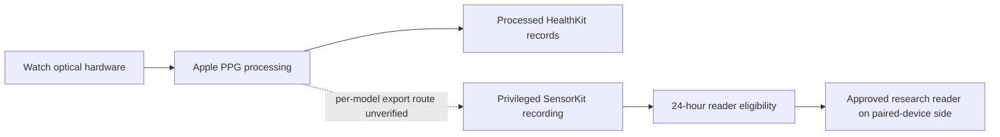

# PAR-WEAR-001 — direct live Apple Watch optical PPG

**Decision: NO-GO for a commercially distributed Parable app capturing direct live
optical PPG on an ordinary, unmodified Apple Watch, on the evidence available
2026-11-11.** Genuine optical waveform export exists through approved SensorKit
research access; its documented 24-hour hold fails this requirement. A concrete
internal hold-exception mechanism appears in published artefacts, but no authorized,
reproducible third-party live Watch acquisition path was established.

This is an access/release feasibility finding, not proof that Apple's hardware or
internal software cannot stream. No Watch application or probe was implemented.
No production DSP, patch, storage, firmware or modulation changes. No motion-based
heartbeat inference, BPM-derived waveform, simulated signal or external sensor is
an alternative result for this assignment.

## Answers to the five questions

| Question | Finding | Evidence / remaining gap |
| --- | --- | --- |
| Where do samples enter watchOS; which services process them? | Physical LED/photodiode acquisition and Apple PPG processing are documented. PPG exporters, writers, decoders and reader-service boundaries are visible in published private artefacts. **The first physical Watch driver, sensor-hub/ADC boundary and complete running process call graph are not established.** | [A08], [R01]–[R06], [R10], [R12]. Historical simulator and iPhone evidence cannot authenticate today's Watch hardware route. |
| Any interface before SensorKit's hold? | No documented public live optical interface found. **A private request flag plus a separate peer entitlement for a hold exception are visible in iOS artefacts.** That concerns access to stored segments, not a proven low-latency sensor subscription. | [A01], [A04]–[A06], [R07]–[R09]. Freshness, delivery cadence and Watch applicability untested. |
| Can a consenting owner use it on an ordinary Watch? | User consent alone does not supply Apple-granted signing capabilities. Supported research authorization can permit delayed PPG export on eligible hardware. No ordinary developer/consumer route to the internal exception was established. | [A06], [A07], [A12], [A13], [R07]. No entitlement or on-device result supplied in this task. |
| Realistic commercial distribution? | **No current release path for this live-PPG feature.** Standard App Review requires public APIs; the available SensorKit entitlement is study-specific research authorization and retains the hold. | [A07], [A11]. A separately negotiated Apple capability/API and explicit release rights would be a new gate, not an existing product plan. |
| What proves live access? | An independently reproducible, correctly signed stock-device capture with authentic optical channel samples, original source timestamps, measured sample age/cadence, permissions and release evidence. | The gated experiment below. Headers, an installed app, or a waveform plot alone do not meet it. |

Evidence labels used here: **documented** means Apple's published contract;
**static** means a named symbol/check in someone else's published artefact;
**inferred** means a plausible connection between those facts; **unverified** means
no appropriate device experiment. No hardware behavior is labelled measured.

## The actual signal and public acquisition architecture

Apple describes reflected-light measurements from emitters/photodiodes and
foreground, background and tachogram processing of PPG [A08]. This establishes
that physiological optical samples exist before heart-rate summaries. It does not
publish the model-specific ADC transport, IOKit driver, sensor-hub protocol,
first userspace receiver or a third-party subscription to that receiver.

SensorKit's `SRPhotoplethysmogramOpticalSample.normalizedReflectance` is a genuine
PPG waveform value in **normalized units**, nullable, with scale that may vary
[A02], [A03]. It is not a documented unprocessed ADC register/count from each
photodiode. Emitter, active-photodiode indices, signal identifier, wavelengths,
sampling frequency, sensor-relative time, conditions and noise metadata provide
channel context. Multiple active photodiodes do not imply separate values for
all physical photodiodes. Native rate and calibration must be read/verified;
LED flashing frequency is not an application delivery-rate guarantee.

The following is a **logical dataflow**, not a verified daemon call graph:



The documented PPG client symbols list **iOS/iPadOS/Mac Catalyst 17.4+**, not
watchOS [A01], [A02]. SensorKit can collect from a paired Watch; that does not make
these symbols a supported watch-native driver. The newer generic `SRReader` and
`samples(matching:)` appear for iOS/iPadOS 27; they return an asynchronous sequence
of **fetch responses** for a request, terminating with request completion [A05].
The word stream in the sensor description or AsyncSequence API does not waive
`SRFetchRequest` eligibility: new recordings are held 24 hours, and a range
intersecting the hold returns no results [A04]. Faster polling cannot alter it.

HealthKit's documented HR/HRV and saved heartbeat-series observation remains a
processed-record path, as Apple DTS explains [A09]; Apple's research FAQ denies
real-time heartbeat access [A10]. These are boundary evidence, not substitutes
for PPG. Live here means finite, measured low latency; the finding does not rely
on interpreting the DTS question's literal zero-latency wording as a physical
requirement. No stored ECG, aggregate HR or inferred beats are offered instead.

## Services and private artefacts: what was actually found

| Component | What the inspected source shows | What it does **not** prove |
| --- | --- | --- |
| Historical watchOS-labelled `HealthAlgorithms.framework` / `HAPPGExporter` | Binary sample input and export enumeration; association with SensorKit sampling protocols [R03]. | A sensor-open command or live app-readable acquisition feed. |
| Historical private `SensorKit.framework` reader/writer | Reader fetch/datastore/XPC concepts; writer sample ingestion with timestamps [R01], [R02]. | The hardware producer's identity or permission for an ordinary app to become a writer/reader. |
| Historical `HealthDaemon.framework` heartbeat datum | Aggregated heartbeat sequence and HRV association [R10]. | Access to pre-processed optical samples, or a complete live per-beat channel. |
| iOS 26 `HealthAlgorithms` / `HAPPGFrameEnumerator` | Binary PPG frame decoding and processing objects, optical/associated sample representation [R05], [R16]. | A Watch device driver or authorization to acquire its input bytes. |
| iOS 26 `SRReaderSensorKitBackend` | XPC-backed reader, datastore, device/metadata fetch and recording operations [R06]. | A live sensor callback or bypass of service-side policy. |
| iOS 26.1 `sensorkitd` / `RDDaemon` | Stored-segment eligibility handling and a separate private hold-exception check [R07], [R08]. | Current Watch daemon equivalence, end-to-end capture latency, third-party eligibility or commercial permission. |
| iOS 26.1 `heartratecoordinatord` | Watch/audio/BLE source objects and processed heart-rate coordination [R12]. | Raw Watch photodiode delivery. |
| Historical CoreMotion workout manager | `CMWorkoutManagerInternal` names a `locationd` connection and workout-event registration [R17]. | A demonstrated raw optical subscription or the current physical Watch acquisition daemon. |
| Private CoreMotion audio-accessory PPG selectors | Names explicitly scoped to audio accessories [R11]. | A Watch optical interface; their existence must not be repurposed as evidence for one. |

The watchOS-labelled headers come from a **simulator** collection whose generator
selects the watchOS simulator and i386 [R04], archived at a 2020 commit. Class-dump
tool timestamps are not watchOS build identifiers. The newer runtime headers are
**iOS** introspection; the daemon pseudocode is labelled iPhone18,3 / iOS 26.1 /
23B85, not a physical Watch trace. These sources are useful implementation clues,
not Apple's API contract. Generated pseudocode can misrepresent control flow and
types. The exact current Watch services and first ADC sample entry remain open.

### The concrete pre-hold lead and its gate

`bypassHoldingPeriod` appears in the historical private reader [R01]. More recent
published `sensorkitd` pseudocode shows an exception branch conditioned on both the
request and a peer-entitlement check [R07], [R08]. The entitlement named there is:

`com.apple.private.sensorkit.reader.holdingperiod.bypass`

An independent extracted entitlement manifest attributes that capability to Apple's
`SensorKitDataExport.xpc` helper [R09]. This corroborates an **internal export
exception**, not an entitlement generally obtainable by a Parable app. It is
separate from the documented research entitlement
`com.apple.developer.sensorkit.reader.allow` with `ppg` [A01], [A06].

This is stronger evidence than merely guessing a private framework might exist.
It still proves neither a raw sensor subscription nor real-time delivery: data
could already have been batched/transferred before an entitled segment fetch.
No private selector, entitlement modification, daemon connection, clock change or
protected-file access was executed. No request flag is presented as a workaround.

## Interface / model / OS / release matrix

| Route | Version/model evidence | Signal and timing | Stock-owner / release result |
| --- | --- | --- | --- |
| Public SensorKit PPG, legacy reader | Client SDK 17.4+; Apple documents generation-specific emitter/PD layouts [A01], [A02]. Exact capture eligibility for each Watch/OS remains to be tested. | Genuine normalized optical samples; native sampling metadata; **at least the documented 24-hour hold**, plus collection/sync/fetch delay. | Possible only with legitimate study authorization and consent; fails direct live requirement. |
| New `SRReader.samples(matching:)` | iOS/iPadOS 27 client [A05]; not a watchOS-native acquisition declaration. | Async fetch of eligible stored samples; no documented hold exemption. | New syntax does not create a consumer live-PPG route. |
| Internal SensorKit hold exception | Historical Watch simulator + iOS 26.1 static evidence [R01], [R07], [R08], [R09]. | Eligible internal archive access appears possible; actual optical source age unknown. | No third-party grant or stock-Watch reproduction established; not a commercial implementation path. |
| HealthKit records/workout observations | Supported public watchOS facilities [A09], [A10]. | Processed or saved records; no direct optical waveform subscription identified. | Does not satisfy this task even when records arrive frequently. |
| Peepo reverse-engineering project | Author reports Series 4, watchOS 10.6.1/10.6.2; Series 5/SE support is qualified by the author [R13]. | Kernel/process memory extraction, not a demonstrated PPG stream. | Requires security exploitation; excluded, not executed or imported. |
| Elcomsoft S4/S5 extraction | Vendor's September 2026 account [R14]. | Bootloader/ramdisk extraction with watchOS **not running**. | Cannot establish live watchOS sensor acquisition; excluded and not executed. |

A public PPG plugin explicitly reports no Apple Watch raw extraction [R15]; its
other-device stream API is not an Apple access path. Search matches for an optical
sensor, an external-accessory API, diagnostics or a memory dump do not constitute
a reproducible stock-Watch waveform subscription. No documented diagnostic logging
route yielding such an application stream was established either.

## Consent, signing and commercial feasibility

Apple must grant SensorKit authorization for an approved study and its signing
profile; users must separately consent to requested sensors [A06], [A07]. Development
and participant-distribution approvals differ; study launch requires the stated
ethics approval and normal app review. A company may conduct an approved study,
but that is not general consumer permission for a musical live-signal feature.

Entitlements are checked against signing/provisioning authorization [A12]. User
ownership, HealthKit approval, Developer Mode or installing through Xcode does
not itself confer the internal SensorKit capability. Developer Mode enables
local development installation; it is not a raw-sensor entitlement [A13]. No cited
App Store, TestFlight or development distribution route grants this capability.

App Review **2.5.1** requires public APIs; **2.5.4** restricts background services to
their intended purposes [A11]. Dynamic loading or reflection does not change that
policy. The private path therefore has an independent release barrier even if a
future experiment could call it. An Apple-negotiated capability with explicit
production rights could change the finding; no such agreement was identified.
Private ABI, packet formats, daemon authorization and model/OS changes would also
require ongoing regression work. There is no defensible maintenance/cost estimate
or release schedule before access and rights are resolved.

## Exact proof required to reopen the decision

These are **conditional future experiments**, not claims of a working route or
authorization to bypass controls. Implement only after Apple documents an eligible
API or legitimately grants an appropriate interface/capability for the stated use.

1. **Reproducible access.** Record model/hardware ID, Watch/iPhone OS builds,
   SDK/Xcode, signed bundle ID, approved provisioning capabilities and consent.
   Use the owner's stock device with no exploit, patched service or security
   modification. Publish a minimal authorized capture source and receipt format;
   verify a fresh install on a second consenting stock device. No credentials or
   personal health data need be published.
2. **Optical identity.** Preserve channel/source metadata, emitter, active PDs,
   wavelength, native frequency, original values/units, nullable values and quality
   flags. Show the data originated from the Watch optical sensor. If literal ADC
   counts are required, obtain and validate that channel contract; normalized
   reflectance cannot be relabelled ADC output. No generation from BPM, movement,
   model output or interpolation. Controlled wrist contact/removal should produce
   corresponding quality/amplitude changes; a plot alone is insufficient proof.
3. **Freshness before hold.** Timestamp a new recording at T0, retain unmodified
   source recording time and optical sensor-relative offsets [A14], [A15], sequence
   numbers and monotonic receipt times. Establish clock conversion and uncertainty
   before subtracting timestamps, including after reboot/reconnect. Show samples
   acquired **after T0** arriving during that session; changing request dates or
   replaying old data fails. Log errors and authorization state, not just silence.
   If research-entitled SensorKit is available, use separate fresh and >24-hour
   control windows: a mixed-age query can return nothing under [A04].
4. **Live performance.** First prove pre-hold access, then measure source age and
   batch size on Watch and receiver separately. Run at least 30 minutes; report
   distributions, gaps, duplicates, rate/channel changes, battery/thermal state,
   app foreground/background, screen dim/off, wrist removal/motion and reconnect.
   A proposed musical research gate is p95 age <=250 ms, p99 <=500 ms and no
   unexplained >1 s batching; these are **proposed targets**, not vendor guarantees
   or a founder-approved product requirement. Raw optical sample timing is not
   automatically a validated individual heartbeat-event timing channel.
5. **Release proof.** Obtain written eligibility for the intended commercial use,
   legitimate production signing capability and a supported distribution route.
   Demonstrate the production-signed build on an ordinary consumer installation,
   without development-only privileges. An internal/development success alone
   cannot justify a shipping live-PPG claim.

Questions prepared for Apple, **not sent**: Is a supported low-latency Watch optical
API available for this purpose? Which models/builds, units, clocks and buffering
contract apply? Is any pre-hold capability grantable to third-party commercial
apps, or is the observed entitlement internal-export only? What production rights
and review requirements would apply? Request the actual supported interface,
not a waiver inferred from a forum or header.

## Method, reproducibility and limits

Read issue #35 and applied its latest direct-optical scope. Public Apple SDK/policy
pages and dated technical paper were checked; published runtime headers, simulator
provenance, daemon pseudocode and named reverse-engineering claims were inspected
read-only. Search scopes included PPG/photoplethysmogram, CoreMotion, HealthAlgorithms,
SensorKit readers/writers, holding-period entitlement and watchOS acquisition.
Negative search results are scoped observations, not proof that no unpublished
interface exists. Some web-rendered Apple pages returned JavaScript stubs; their
first-party DocC JSON/Markdown supplied symbol availability and full text instead.
The PDF was read locally after the web reader's size limit.

[Source ledger](PAR-WEAR-001-sources.json) records 32 checked public sources, pinned
community revisions, retrieval URLs and response-body SHA-256 values. Official
pages can change; hashes identify what was retrieved, not runtime verification.
No third-party implementation/header or extracted Apple binary was imported.

Base main `8f943681ad933f7d8b65d1d66535aa811c75c48e` (merged PR #33), tree `7c192aa`.
Applicable AGENTS/Constitution/status/README were read; root AGENTS.md is absent,
project AGENTS.md exists. Before documentation edits, clean GCC 14.2 / CMake 3.31.6
host builds passed **23/23 Debug (130.21 s)** and **23/23 Release (51.48 s)**:

```bash
cmake -S parable-starter -B /workspace/work/wear001-before-Debug -DCMAKE_BUILD_TYPE=Debug
cmake --build /workspace/work/wear001-before-Debug -j2
ctest --test-dir /workspace/work/wear001-before-Debug --output-on-failure --no-tests=error
cmake -S parable-starter -B /workspace/work/wear001-before-Release -DCMAKE_BUILD_TYPE=Release
cmake --build /workspace/work/wear001-before-Release -j2
ctest --test-dir /workspace/work/wear001-before-Release --output-on-failure --no-tests=error
```

These verify preserved repository software, **not Apple acquisition**. No Mac/Xcode
probe build, Apple-granted entitlement, physical Watch capture, sample-rate/latency/
battery measurement or commercial approval was verified. No device security was
bypassed; no person's health data was acquired. No purchasing, deployment or vendor
messages. Existing CI is retained unchanged; PR records its actual results.

Next smallest action is a founder-authorized vendor access/rights clarification.
Until that changes the access gate, keep direct live Apple optical PPG **NO-GO**;
do not replace the requested signal or implement a speculative adapter.

## References

Source IDs link to the cited page; retrieval bodies and provenance are in the ledger.

[A01]: <https://developer.apple.com/documentation/sensorkit/srsensor/photoplethysmogram>
[A02]: <https://developer.apple.com/documentation/sensorkit/srphotoplethysmogramopticalsample>
[A03]: <https://developer.apple.com/documentation/sensorkit/srphotoplethysmogramopticalsample/normalizedreflectance-9aidm>
[A04]: <https://developer.apple.com/documentation/sensorkit/srfetchrequest>
[A05]: <https://developer.apple.com/documentation/sensorkit/srreader/samples(matching:)>
[A06]: <https://developer.apple.com/documentation/sensorkit/configuring-your-project-for-sensor-reading>
[A07]: <https://healthresearch.apple.com/resources/accessing-sensorkit-data/>
[A08]: <https://www.apple.com/health/pdf/Heart_Rate_Calorimetry_Activity_on_Apple_Watch_November_2024.pdf>
[A09]: <https://developer.apple.com/forums/thread/806255>
[A10]: <https://healthresearch.apple.com/faq/>
[A11]: <https://developer.apple.com/app-store/review/guidelines/>
[A12]: <https://developer.apple.com/library/archive/technotes/tn2415/_index.html>
[A13]: <https://developer.apple.com/documentation/xcode/enabling-developer-mode-on-a-device>
[A14]: <https://developer.apple.com/documentation/sensorkit/srphotoplethysmogramsample/startdate>
[A15]: <https://developer.apple.com/documentation/sensorkit/srphotoplethysmogramopticalsample/nanosecondssincestart>
[R01]: <https://github.com/LeoNatan/Apple-Runtime-Headers/blob/5e50ad05dfd7d7b69fc2e0e685765fc054166b3c/watchOS/PrivateFrameworks/SensorKit.framework/SRSensorReader.h>
[R02]: <https://github.com/LeoNatan/Apple-Runtime-Headers/blob/5e50ad05dfd7d7b69fc2e0e685765fc054166b3c/watchOS/PrivateFrameworks/SensorKit.framework/SRSensorWriter.h>
[R03]: <https://github.com/LeoNatan/Apple-Runtime-Headers/blob/5e50ad05dfd7d7b69fc2e0e685765fc054166b3c/watchOS/PrivateFrameworks/HealthAlgorithms.framework/HAPPGExporter.h>
[R04]: <https://github.com/LeoNatan/Apple-Runtime-Headers/blob/5e50ad05dfd7d7b69fc2e0e685765fc054166b3c/generate_headers.sh>
[R05]: <https://github.com/qingralf/iOS26-Runtime-Headers/blob/cbf1d4c4122f3c6807eba36693581882640e5c6c/PrivateFrameworks/HealthAlgorithms.framework/HAPPGFrameEnumerator.h>
[R06]: <https://github.com/qingralf/iOS26-Runtime-Headers/blob/cbf1d4c4122f3c6807eba36693581882640e5c6c/Frameworks/SensorKit.framework/SRReaderSensorKitBackend.h>
[R07]: <https://github.com/EthanArbuckle/iPhone18-3_26.1_23B85_Restore/blob/90aa0cfe59d9682b4265e1354c8b19ec3c7823ab/usr/libexec/sensorkitd/NSXPCConnection.mm>
[R08]: <https://github.com/EthanArbuckle/iPhone18-3_26.1_23B85_Restore/blob/90aa0cfe59d9682b4265e1354c8b19ec3c7823ab/usr/libexec/sensorkitd/RDDaemon.mm>
[R09]: <https://github.com/Lessica/iOS-Entitlements-Database/blob/bb601fbba5c5f7174da15dcaac2d417dd5aa96ea/entitlements/23C55__iPhone12,3_5/System/Library/Frameworks/SensorKit.framework/XPCServices/SensorKitDataExport.xpc/SensorKitDataExport.xml>
[R10]: <https://github.com/LeoNatan/Apple-Runtime-Headers/blob/5e50ad05dfd7d7b69fc2e0e685765fc054166b3c/watchOS/PrivateFrameworks/HealthDaemon.framework/HDHeartbeatSequenceSensorDatum.h>
[R11]: <https://github.com/qingralf/iOS18-Runtime-Headers/blob/cfdd406d3a0bbac8473571dda5482e155b1cc402/Frameworks/CoreMotion.framework/CMAudioAccessoryManager.h>
[R12]: <https://github.com/EthanArbuckle/iPhone18-3_26.1_23B85_Restore/blob/90aa0cfe59d9682b4265e1354c8b19ec3c7823ab/usr/libexec/heartratecoordinatord/HRCSourceController.mm>
[R13]: <https://github.com/datalocaltmp/peepo/blob/6d20d676f7c2d1620ba4764f7500baa906d67b64/README.md>
[R14]: <https://blog.elcomsoft.com/2026/09/low-level-extraction-of-the-apple-watch-s4-s5/>
[R15]: <https://github.com/kuprel/ppg_plugin/blob/aa6c9ad87cf7f1a5a928e70f0727d87ae784ddfb/README.md>
[R16]: <https://github.com/qingralf/iOS26-Runtime-Headers/blob/cbf1d4c4122f3c6807eba36693581882640e5c6c/PrivateFrameworks/HealthAlgorithms.framework/HAPPGFrame.h>
[R17]: <https://github.com/LeoNatan/Apple-Runtime-Headers/blob/5e50ad05dfd7d7b69fc2e0e685765fc054166b3c/watchOS/Frameworks/CoreMotion.framework/CMWorkoutManagerInternal.h>
